一张伪装网看起来很朴素：几根支撑杆，一层网底，再加上颜色斑驳、形似枝叶的饰片。但它背后的问题并不朴素——**当观察者从地面的眼睛变成空中的照相机，再变成热像仪和雷达，怎样才能让一个人工目标不显得突兀？**

我上一篇文章讨论了美军网具的六角主屏与菱形填充屏。这次把视角拉远，看看伪装遮障怎样成为一种工业装备，又怎样走到今天的多光谱特征管理。俄乌冲突中出现的道路防无人机网和车顶防护笼，还提示了另一条发展路径：遮障不仅可以妨碍目标被发现，也可以在目标已经被发现后，干扰来袭武器接近和攻击。

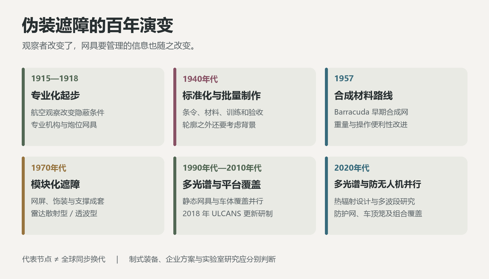

*图 1：遮障发展的主要节点。材料、结构与功能不断演变，不同代际的网具长期并存。*

## 一、从天然隐蔽到人工遮障

**遮障是用于妨碍敌方探测和干扰敌方武器攻击的遮蔽物，分为天然遮障和人工遮障。** 这两项功能可以兼有，也可以有所侧重：伪装网主要帮助目标融入背景，防无人机网则主要通过物理阻隔干扰攻击。

**天然遮障**是能够遮蔽目标、妨碍空中或地面探测的现有地形与地物，例如合适的植被、居民地、较深的地沟和起伏地形的反斜面。“天然”侧重利用现有环境，居民地等人工地物也可以提供这种遮蔽。**人工遮障**则由伪装装备或就便材料制作、设置，包括制式网具、临时覆盖结构、防无人机防护网与防护笼。[22](#ref-22)

伪装、遮障和伪装网因而不能简单画等号：伪装是一组降低目标可识别性、改变观察者判断的措施，遮障是实现隐蔽或干扰攻击的遮蔽物，伪装网则是人工遮障中的常见柔性器材。烟幕、涂装、个人迷彩和假目标可以与其协同；它们的具体作用仍需分别说明。英文资料中，*camouflage net*、*protective netting*、*overhead protection*、*cage armour* 和 *mobile camouflage system* 也各有侧重，不宜机械地用一个英文词覆盖全部概念。

| 概念 | 主要作用 | 功能特点 |
| --- | --- | --- |
| 隐蔽（concealment） | 降低目标被发现或识别的机会 | 隐蔽不等于能够抵挡弹片、爆炸或穿透 |
| 天然遮障 | 利用现有地形、植被和地物遮蔽目标 | 同一地物对不同观察方向和波段的遮蔽能力不同 |
| 人工遮障 | 通过新设的覆盖、屏障等妨碍探测或干扰攻击 | 隐蔽型、物理防护型和兼具两种功能的结构应分别评价 |
| 伪装网 | 便于折叠、拼接和重复使用的柔性遮障 | 网底、饰装层及功能涂层并不一定承担相同任务 |
| 防无人机网与防护笼 | 主要通过外部结构干扰无人机或弹药接近、接触目标 | 物理防护能力与光谱隐蔽能力是不同指标 |
| 欺骗（deception） | 使观察者对目标性质、位置、数量或意图作出错误判断 | 假目标与隐蔽真目标可以配合，但不能互相替代 |
| 特征管理（signature management） | 综合管理目标在不同传感器中的可观测特征 | 不意味着所有波段都能“完全隐身” |

这里的 *signature* 译作“特征”比直接说“签名”更直观：一辆车可能有视觉轮廓、近红外反射特征、热辐射分布和雷达散射特征。观察者不一定需要看清全部细节，只要某一种特征足够异常，就可能产生怀疑。

人工遮障还有不同的设置形态。水平网面主要遮挡上方观察，垂直或倾斜网面主要遮挡侧向视线，覆盖在目标外部的网具则可以沿装备外形展开。按作用方式，又可以区分遮住目标的掩盖结构，以及改变其外部轮廓的变形结构。反雷达遮障描述的是电磁功能，同一张网具可以同时具有某种设置形态和某种波段特性。[31](#ref-31)[35](#ref-35)

利用地形、夜暗、植被和示假行动隐藏兵力与意图，是军事隐蔽的古老经验。《孙子兵法·虚实》的“形人而我无形”，表达了控制敌方认知的重要性。现代伪装网将这种隐蔽需求落实为可制造、可运输、可反复架设的器材，使遮蔽能力逐渐摆脱对现场天然条件的完全依赖。

## 二、一战：飞机把炮位伪装变成了专业工作

### 观察视角改变，旧的隐蔽条件也改变了

从地面看，一道土坡或一片林缘可能挡住火炮；从空中看，炮位与道路、新翻土、阴影和周围活动却可能呈现出另一幅图景。航空侦察与炮兵作战的结合，使隐蔽不再只是躲开对面阵地上的观察员，也需要应对俯视观察。

**1915 年，法国陆军建立了专业伪装机构。** 伪装逐渐由临时经验，发展为有专门人员、制作工场和任务分工的工作。专业组织能够集中制作炮位遮障、伪装观察所等器材，并把前线经验带回工场改进。[1](#ref-1)

早期网具的基本思路并不复杂：柔性的承力网提供展开结构，麻布等饰条提供颜色与纹理，框架使网面罩在目标外部。这样既能遮蔽装备，也能用不规则的表面削弱人工轮廓。艺术家的价值在于理解形状和视觉错觉，工兵与制作人员则把这些想法变成可用器材。

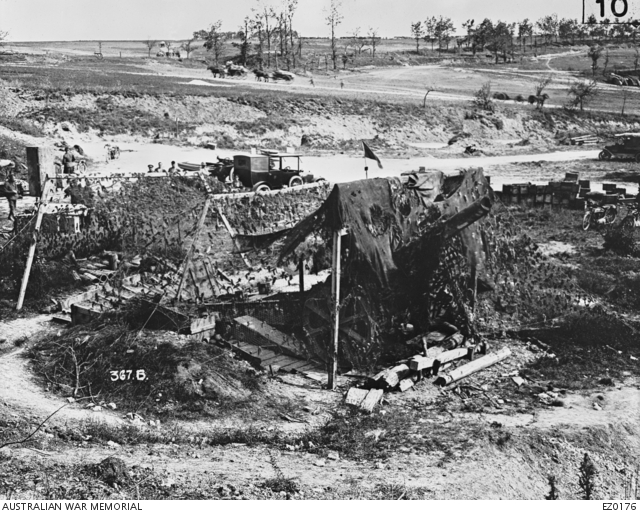

*图 2：附有麻布饰条的网具架在木框上，覆盖一门缴获的德国六英寸火炮，约 1916—1917 年。摄影：British Official Photographer；澳大利亚战争纪念馆藏，编号 EZ0176；馆藏页标注为公有领域。[馆藏记录](https://www.awm.gov.au/collection/C358197)。[2](#ref-2)*

这张照片展示了现代网具已经具备的三个基本环节：**承力、饰装和支撑**。饰条使网面不只是均匀的孔洞；支撑框架则把柔性材料变成空间遮障。现代系统的功能更复杂，但这条结构逻辑并没有消失。[2](#ref-2)

专业机构的出现还意味着一件事：伪装效果可以被反复观察、讨论和改进。单纯觉得“颜色差不多”已经不够，目标从哪个方向看、哪种阴影暴露了它，都成为需要处理的问题。

### 从枝叶和帆布，到带饰装的网具

早期炮位遮蔽的困难，首先来自材料本身。鲜枝叶容易取得，却会在几天后枯萎，失去与背景一致的外观；涂漆帆布可以覆盖较大面积，但平滑表面缺少植被的细碎纹理，在雨后或某些光照角度下容易反光，使画出的图案失去作用。网具上的饰装则把颜色与立体纹理结合起来，成为另一条改进路线。[37](#ref-37)

一战期间，渔网上曾附加涂色的拉菲草束。这种植物纤维轻便，但易燃、染色易褪，防火处理也难以持久；帆布饰条在制造方面更方便，却仍有易燃问题。炮位遮障还发展出较密的中心覆盖区与逐渐稀疏的边缘：中心遮住目标，外围饰条使网面与背景之间的明暗过渡更加柔和，减弱整幅遮障的边界和投影。[37](#ref-37)

这些改进说明，专用伪装网的形成不只是给渔网换上颜色。材料能否保持纹理、经受天气变化、方便制造和安全使用，与它从空中看起来是否自然，同样影响网具的实用价值。

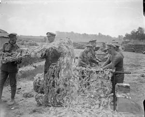

*图 3：1918 年 6 月 16 日，英军在法国 Basseux 制作伪装网，网体上附加的饰装形成不规则纹理。摄影：John Warwick Brooke。Image: IWM (Q 6752)，依 [IWM 非商业许可](https://www.iwm.org.uk/corporate/privacy-copyright)使用。[馆藏记录](https://www.iwm.org.uk/collections/item/object/205091950)。[39](#ref-39)*

### 从制作工场到专业学校

1916 年，英国在伦敦肯辛顿花园建立伪装学校，将已有的训练战壕变成遮蔽与视觉欺骗的试验场。画家、舞台布景设计师、雕塑家、摄影师和工匠参与其中，既研究如何掩藏阵地，也制作能够改变观察者判断的模型和道具。网具编织同样成为这套专业工作的组成部分。[29](#ref-29)

艺术经验与工程制作在这里相遇：画家擅长处理色彩和明暗，舞台设计师熟悉用轻质结构塑造外观，摄影师则帮助人们理解俯视画面。随着任务扩大，这些技巧逐渐与材料、结构和训练结合。战后，相关经验还通过专著传播；Solomon J. Solomon 于 1920 年出版《战略伪装》（*Strategic Camouflage*），伪装成为专门讨论的军事技术主题。[29](#ref-29)[30](#ref-30)

## 三、二战：从遮住一门炮，到标准化供应和伪装纪律

### 条令把经验拆成了可以训练的规则

1944 年美国陆军《FM 5-20A：个人与步兵武器的伪装》在开头列出形态、阴影、纹理和颜色，并要求同时考虑地面与空中观察。它还把反光、背景、运动、废弃物和不必要的活动痕迹放进同一份检查清单。[3](#ref-3)

**盖上网，只改变了目标暴露的一部分。** 周围的背景和活动同样会提供信息。因此，二战时期的伪装训练已经将网具架设、环境处理和日常维护联系起来，强调隐蔽效果需要持续保持。

该手册中的机枪平顶遮障使用饰装网，说明网具已是常规器材；其系列目录还分别列出车辆、炮兵、固定设施以及伪装材料与制造技术。不同对象的伪装开始拥有较明确的知识分工。[3](#ref-3)

### 小网眼与大网眼：不同网具承担不同任务

同年出版的《FM 5-20B：车辆伪装》区分了两类车辆覆盖网：小网眼的“虾网”（*shrimp net*），以及附有饰装材料的大网眼绳网。前者以密集网面改变车辆外观，后者则借助麻布等饰条，在承力网之外形成颜色和纹理层。[31](#ref-31)

手册还指出，遮障本身即使被观察到，也可以使其下方装备的身份难以辨认。伪装的作用由此包含两个层次：降低被发现的机会，以及在被发现后延缓识别。[31](#ref-31)

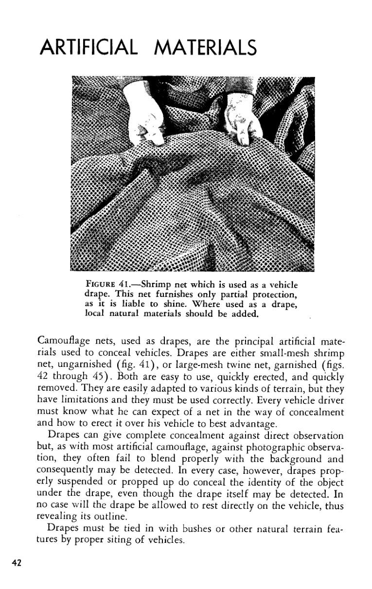

*图 4：1944 年《FM 5-20B》第 42 页，“虾网”车辆覆盖示例及大网眼饰装绳网说明。[手册扫描本](https://ciehub.info/ref/FM/5-20B_1944.pdf)。[31](#ref-31)*

### 阴影成为需要处理的目标特征

车辆外轮廓被网面遮住后，阴影仍可能暴露其结构。车厢下方、驾驶室、轮罩和车轮内部的暗部，在航空照片中都可能成为识别线索。二战车辆伪装手册已经将整体投影与这些局部阴影分别讨论，强调网具、自然材料和背景之间的衔接。[31](#ref-31)

遮障因此不仅覆盖物体，也改变物体周围的明暗关系。阴影的面积、边缘和方向随太阳位置变化，网面与支撑结构塑造的外形也会形成新的投影，空间结构逐渐成为伪装设计的重要部分。

### 大规模制造背后，也有具体的人

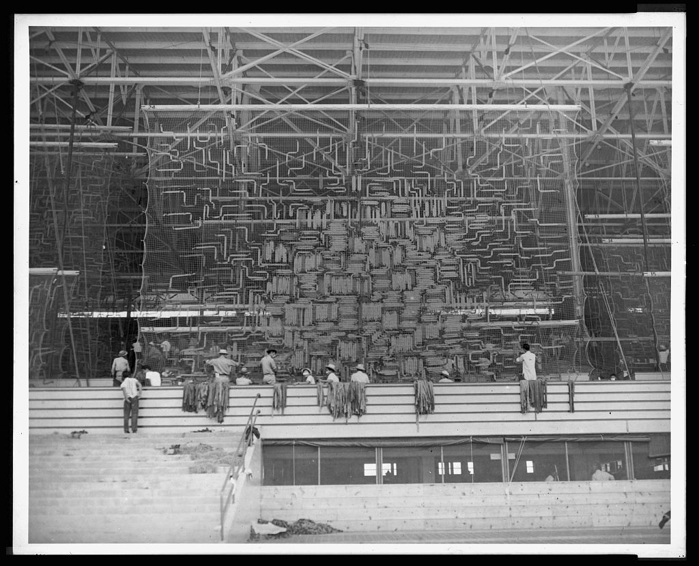

*图 5：1942 年，被拘禁的日裔美国人在圣安妮塔临时拘禁中心制作伪装网。摄影：Julian F. Fowlkes；美国国会图书馆藏，LC-USZ62-134614，馆藏标注“未发现出版限制”。[馆藏记录](https://www.loc.gov/pictures/item/2005684116/)。[4](#ref-4)*

制作现场将大幅网具悬挂起来，工人可以站立编织；网具在打包前由陆军检查人员逐张检验。这样的生产组织将手工饰装、批量制作与军方验收连接起来，成为战时器材供应链的一部分。[4](#ref-4)

二战时期形成的体系，已经远超“找点树枝盖上去”：制式材料、成套网具、条令、训练和检查相互配合。材料仍然相对传统，但伪装遮障已经成为能够批量生产、分发和维护的装备。

### 把飞机工厂藏进一片“居民区”

二战中的人工遮障，也被用于整个工业设施。珍珠港事件后，美国陆军组织伪装洛克希德位于加利福尼亚州伯班克的飞机工厂。John F. Ohmer 上校招募附近电影公司的艺术家、布景设计师和画师，将舞台布景经验用于厂区的空中外观设计。[38](#ref-38)

工厂主体上方设置由铁丝网、网具和涂漆帆布组成的覆盖层，机场与停车场被处理成田地般的外观，假树和仿住宅结构则补充地面景物。假树的“叶片”使用喷漆鸡毛，绿色与棕色模拟不同植被状态；员工休息时还配合晾晒、收取衣物，使这片人工“居民区”呈现日常生活的迹象。[38](#ref-38)

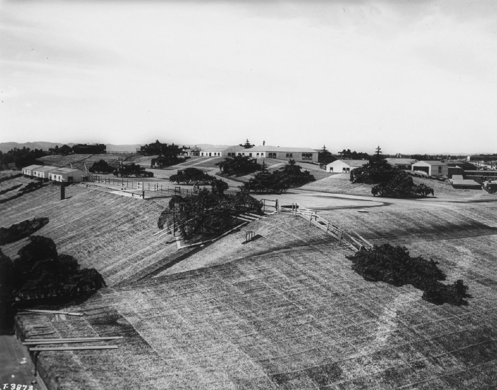

*图 6：二战期间，洛克希德伯班克工厂上方的人工景观。覆盖层、假建筑、树木与道路景物共同构成仿居民区外观，工厂位于其下方。图片来源：Lockheed Martin，[工厂伪装历史资料](https://www.lockheedmartin.com/en-us/news/features/history/camouflage.html)。[38](#ref-38)*

这类工程将遮障从单件装备的覆盖，扩大到设施与周围景观的整体重构。承力结构、覆盖材料、仿形景物和人员活动共同塑造空中可见的场景，目标不仅被遮住，还被赋予另一种用途和身份。

### 改变外形，并把遮障纳入整体欺骗

1942 年第二次阿拉曼战役前，盟军实施“伯特伦行动”（*Operation Bertram*），将真实装备的伪装与假装备结合起来。其中，“Sunshield”覆盖结构把坦克装扮成卡车，改变空中观察者对车辆性质的判断。遮障在这里不只是盖住一辆坦克，而是给它塑造另一种可识别外形。[32](#ref-32)

1944 年诺曼底登陆前的“坚忍南方行动”（*Fortitude South*），则在英格兰东南部部署假坦克、假车辆和假登陆艇，并配合虚假无线电通信与情报欺骗，营造在加来方向登陆的假象。遮蔽真实力量、展示虚假力量和提供与之相符的通信活动，共同影响敌方判断。[33](#ref-33)

同年成立的美军第 23 总部特种部队，即“幽灵军团”，把充气假装备、声效、无线电欺骗和人员扮演结合起来，执行战术欺骗任务。它体现了伪装专业的进一步扩展：材料与结构塑造可见外观，其他手段则为这种外观补充活动迹象。[34](#ref-34)

## 四、冷战：合成材料减轻负担，新的传感器改变任务

### 1957 年的合成网，是材料路线的代表节点

**1957 年，Carl Ekman 以渔网制造为基础开发的合成伪装网向瑞典国防装备机构展示，随后开始交付。** 这是 Barracuda 产品发展的重要节点。与笨重的传统纺织品和黄麻网相比，合成网为减轻重量、改善操作和重复使用提供了新的材料路线。[5](#ref-5)

合成材料的意义，在于给承力网、饰装层和表面涂层提供更多组合空间。设计者不仅可以改变颜色，还能考虑重量、耐候性、吸水、耐久和加工方式。**轻量化改善的是携行与部署，光谱设计改善的是传感器中的表现；二者可以结合，但不能混为同一指标。**

### 1963 年的苏联 MKT：标准网片与快速连接

苏联国防部 1963 年出版的 MKT 制式伪装套件使用说明，已经采用标准构件组织网具：一套 12 × 18 米覆盖面由 12 块 3 × 6 米网片组成，以连接绳和不同接缝组合。部分接缝能够快速解开，方便装备解除覆盖。网片可以整套使用，也可以拆分或组合为更大的遮障。[35](#ref-35)

手册列出适应植被、裸露地面和雪地的不同类型，并说明同一套件可以形成覆盖、顶棚以及垂直、倾斜遮障。模块化在这里首先解决的是尺寸适配、操作与保障：用有限种类的标准构件，组合不同的空间结构。[35](#ref-35)

### 1970 年代的模块化，解决了整套系统的组织问题

1975 年秋季号《The Engineer》报道了美军 MERDC 研制的轻型模块化遮障。报道列出聚酯承力网、两面带聚氯乙烯涂层的纺粘尼龙饰装材料、快速连接件，以及六角主屏和菱形填充屏，并将耐久性、抗水和油吸收能力、操作便利性列为改进。[6](#ref-6)

同一报道还区分**雷达散射型**与**雷达透波型**：如果被覆盖装备本身需要使用雷达，遮障的电磁任务就不能与其他目标完全相同。[6](#ref-6)

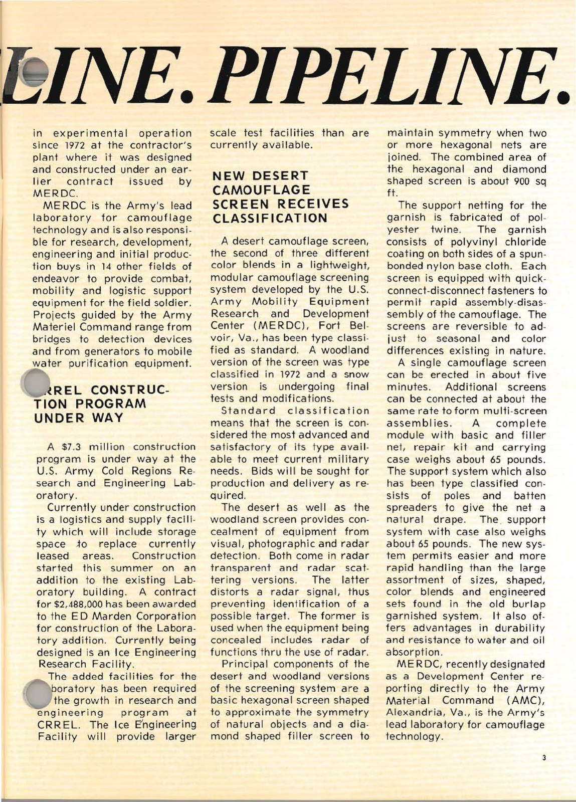

*图 7：1975 年《The Engineer》秋季号第 3 页，中栏起的报道为“New Desert Camouflage Screen Receives Classification”。原文同时讨论材料、模块、连接件、支撑系统和雷达特性。[原始期刊](https://home.army.mil/wood/7217/8429/9084/Fall_1975.pdf)。[6](#ref-6)*

这次变化的单位已经是“系统”，而非一块更好的布：标准模块适配不同覆盖范围，支撑装置塑造空间外形，连接件影响反复操作，功能材料决定波段表现。关于六角形和菱形组合的细节，可接着读我此前的[网具模块研究](../20261005/)。

### 中国制式网具的系列化发展

中国也逐步形成多种型号的制式伪装网。2022 年《现代防御技术》的综述列出 65 式、72 式、81 式、84 式、87 式和 95 式等型号，将伪装网与人造遮障树、民用化篷布顶棚等共同纳入遮蔽技术。制式网具提供可批量生产和配套使用的器材，其他结构则针对目标形状和现场环境补充遮蔽能力。[36](#ref-36)

### 来自空中和太空的观察，扩大了可见信息

1960 年 8 月，CORONA 完成首次完全成功的摄影侦察任务，将军事摄影观察延伸到太空。1972 年发射的民用地球观测卫星 Landsat 1，则携带覆盖可见光和近红外的四波段多光谱扫描仪，使地表能够按不同波段被记录和分析。[7](#ref-7)[8](#ref-8)

俯视成像与分波段观测扩大了目标可能暴露的信息。随着红外和雷达传感器的发展，遮障设计开始同时关注视觉轮廓、材料光谱、热辐射和电磁散射，评价标准逐渐超出人眼所见。

## 五、为什么“看起来像草”，并不等于多光谱伪装？

所谓多光谱，不是把更多迷彩颜色印上去，而是让同一目标在多个观测波段中都减少异常。这里先区分两类信号：目标**反射外部照明**，以及目标**自身发出热辐射**。雷达还会主动发射电磁波，测量返回的散射信号。[9](#ref-9)[10](#ref-10)

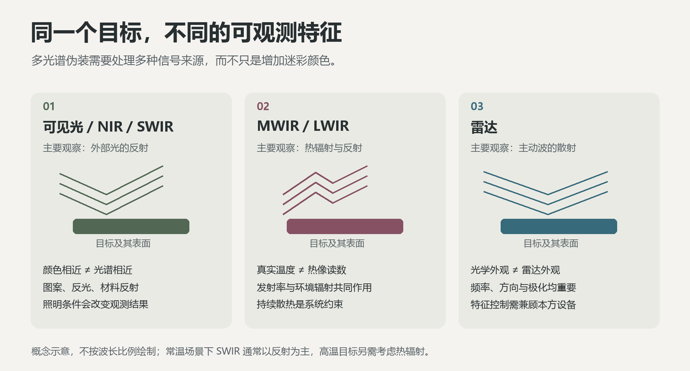

*图 8：多光谱观察的三类信号来源：外部光的反射、热辐射与环境辐射反射、雷达波的散射。概念示意，波段不按比例绘制。[9](#ref-9)[10](#ref-10)*

| 观测范围 | 主要观察什么 | 遮障需要处理的问题 |
| --- | --- | --- |
| 可见光，约 0.4—0.78 μm | 外部光照下的颜色、轮廓、纹理和反光 | 与背景的视觉关系及结构差异 |
| 近红外 NIR，约 0.78—1.4 μm | 主要是外部光的反射 | 可见颜色相似的材料，近红外反射可能不同 |
| 短波红外 SWIR，约 1.4—2.5 μm | 常温场景通常以反射为主，高温目标还需考虑热辐射 | 需要同时考虑照明、温度与材料光谱 |
| 中波红外 MWIR，常见窗口 3—5 μm | 热辐射及反射的环境辐射 | 表面温度、发射率与背景辐射共同作用 |
| 长波红外 LWIR，常见窗口 8—14 μm | 常温物体的热辐射与环境辐射反射 | 减小辐射对比，还需兼顾持续散热 |
| 雷达，波长与频率依系统而异 | 目标的电磁散射 | 材料、结构、入射方向、极化和频率都可能影响回波 |

*表中采用常见波段划分，具体仪器的工作范围有所不同。[9](#ref-9)[10](#ref-10)*

### 红外图像不是表面真实温度的直接照片

讨论热伪装时，一个常见误会是：热像仪显示得“冷”，就说明材料真的降低了温度。实际上，热像仪接收到的是辐射；温度读数还依赖发射率、环境反射和仪器设置。忽略大气路径影响，对不透光表面可用下面的简化关系帮助理解：

$$
L_{\lambda,\mathrm{obs}} \approx \varepsilon_\lambda B_\lambda(T_s)
+ (1-\varepsilon_\lambda)L_{\lambda,\mathrm{env}} .
$$

其中 $T_s$ 是表面真实温度，$B_\lambda$ 是黑体谱辐亮度，$\varepsilon_\lambda$ 是光谱发射率，$L_{\lambda,\mathrm{env}}$ 是被表面反射的环境辐射。实际观测还要考虑角度、传感器响应和大气传输；有孔隙、可透射的网具不能直接当成上述不透光表面。[9](#ref-9)

由此可见，**降低发射率，降低真实温度，以及匹配背景辐射，是三个相关但不同的目标。** 更低的信号也不必然更像背景：一个异常偏暗的区域同样可能显眼。材料评价最终要回到目标与背景的对比，而非追求某一个数值无限减小。

## 六、当代装备：静态网具与平台覆盖并行发展

### ULCANS：多光谱网具已经是明确的装备任务

2018 年，美国陆军启动 ULCANS Increment I 竞争原型研制，对既有网具体系进行新一轮更新。系统面向全天候多光谱遮蔽，计划更新此前的林地与沙漠型装备，并发展适应林地、雪地／高山和沙漠／城市的变型。[11](#ref-11)

同年，Aberdeen Test Center 为新网具安排了跨环境、跨光电波段及雷达的测试，并由观察人员参与评估。测试从材料响应延伸到成套器材的使用，考察目标、背景和观察者之间的综合关系。[12](#ref-12)

*图 9：格陵兰雪地环境中的 ULCANS 网具测试。图片：U.S. Army，2018 年。[报道与原图](https://www.army.mil/article/206368/army_netting_modernized_camo)。[11](#ref-11)*

2026 年 4 月公开的美国陆军 FY2027 研发预算说明，继续列出 ULCANS 的特征增强任务和车辆机动伪装系统的研发目标。静态遮障改进与车辆平台特征管理，成为并行推进的两条装备发展路线。[13](#ref-13)

### Barracuda MCS：从罩在目标上方，到适配平台外表面

Saab 的 Barracuda MCS 采用车辆外形定制的覆盖系统，以组合材料调节电磁特性，并兼顾热管理。与架设在静止目标外部的通用网具相比，它需要贴合车体布置，在车辆运动中保持覆盖，并为维修和外部设备使用留出空间。[10](#ref-10)

2018 年公布的 Adjustable MCS 采用可调整的面板配色，使同一套覆盖系统能够适应不同背景。这种调整依靠面板配置完成，适合在地域或季节变化时改变车辆的整体外观。[14](#ref-14)

与通用静态网具相比，车辆覆盖系统还要兼顾行驶、维修、散热和外部设备使用。多波段材料提供光谱能力，平台适配则决定这些材料怎样布置、连接和维护。

### FSS：伪装还要与本方设备共存

Saab 在 2023 年介绍 ULCAS-FSS，尝试通过频率选择表面，兼顾某些雷达频率的控制与通信、GPS 信号的通过。其公开说明的核心是：电磁波通过与衰减可以按频率进行设计，而不是对所有频率采取同一种响应。[15](#ref-15)

FSS 通过结构对不同频率产生不同的透射、反射或吸收响应，是被动频谱设计的一种方式。它按电磁波特性工作，性能还受到入射方向和使用条件影响。对于现代遮障而言，管理敌方可利用的信号与保持本方通信能力，是需要同时解决的工程问题。[15](#ref-15)

### 进步还发生在支撑与部署结构上

Vehicle-Integrated Camouflage System 是车载网具结构改进的一个实例。士兵与大学合作开发原型，并在 2024 年进行测试，通过改善网具与车辆的结合，减少架设所需的时间和劳动。[16](#ref-16)

这类进展很容易被材料新闻遮住，却与早期模块化改革一脉相承：器材能否随平台使用、反复展开、收纳和维护，会决定实验室性能有多少能够进入日常装备使用。

## 七、俄乌冲突中的新分支：防无人机网与车顶防护笼

### 无人机威胁推动顶部防护发展

无人机把侦察与攻击联系得更紧密：侦察无人机提供图像，投弹无人机从上方释放弹药，携带战斗部的第一人称视角无人机（FPV，*first-person view*）则由操作者通过机载画面控制飞行。FPV 描述的是观察、操控方式，本身并不等于某一种战斗部或某一种制导武器。[25](#ref-25)

在这一背景下，遮障出现了不同于多光谱材料的作用路径：目标即使仍然可见，外部网具或框架也可能阻碍飞行器接近、限制直接接触，或者改变弹药与目标相互作用的条件。**前者主要作用于探测和识别，后者主要作用于接近和攻击；它们可以共同服务于生存性。**

俄乌双方为车辆和炮兵阵地使用网具、金属围栏和金属笼制作就便顶部覆盖，将原本偏重侧面的防护扩展到上方。这类结构主要针对投弹无人机和小型攻击无人机；抵抗炮弹直接命中，则需要强度更高、资源投入更大的顶盖。[25](#ref-25)

### 道路防护网：从单件器材扩展到交通空间

道路上方和两侧的防护网，外观可能像狭长的网罩或“网隧道”。它不必具有植被颜色，也不一定使道路上的车辆难以被看见；其主要任务，是给无人机与被保护对象之间增加物理阻隔。

**2026 年 2 月，苏格兰政府宣布向乌克兰提供约 280 吨废旧鲑鱼养殖网**，用于道路等对象的防无人机防护。网材通过缠绕无人机螺旋桨，阻碍其抵达目标。原本准备回收的养殖网转作防护材料，延续了利用就便器材设置遮障的传统。[23](#ref-23)

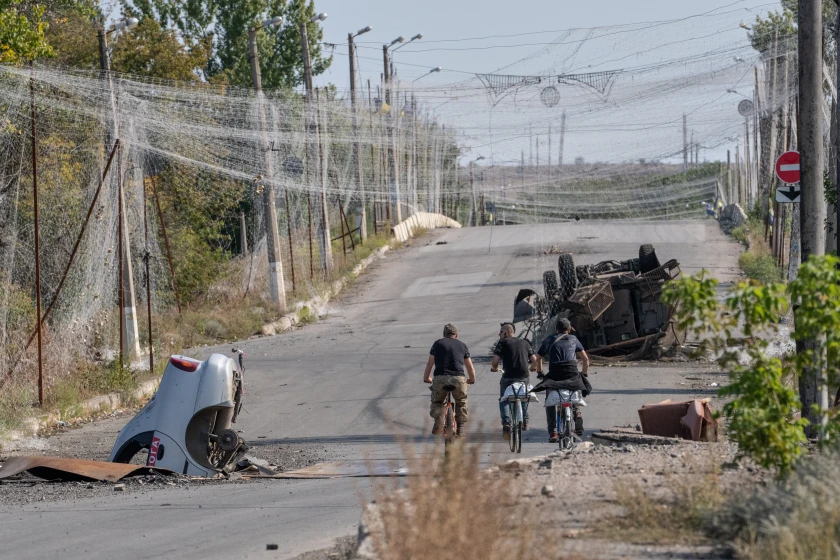

*图 10：乌克兰德鲁日基夫卡（Druzhkivka），乌军人员骑自行车穿过道路防无人机网下方，2026 年 9 月 12 日。摄影：Iryna Rybakova／乌克兰第 93 机械化旅，经 AP 分发；图片载于 [WHCP 转载的 NPR 报道](https://www.whcp.org/2026-10-05/drones-buzz-overhead-troops-hunker-underground-in-ukraines-hellish-kill-zone)。[40](#ref-40)*

乌克兰国家特别运输服务部门在 **2025 年于七个州设置了 534 公里道路防无人机防护**。从单个阵地的临时覆盖，到沿道路延伸的连续结构，防护网的应用已扩展为有组织的交通防护工程。[24](#ref-24)

道路防护网与传统伪装网的共同点，是通过网材、支撑结构及维护形成遮障；区别则在于评价对象。伪装网要检查目标与背景的可观测差异，防护网还需要验证物理阻隔是否有效、破损后能否恢复，以及是否妨碍正常通行。结构仍在，不代表功能始终完整。

### 车顶防护笼：外部防护结构，也可以成为覆盖层的支架

车顶防护笼是附设于车辆外部的框架、格栅或网状覆盖结构，英文俗称 **cope cage**。它既可以提供顶部物理阻隔，也可以作为网具和伪装覆盖层的支撑。

笼状结构延续了装甲车辆外部附加防护的思路。俄乌冲突期间，这类结构在坦克和自行火炮上快速扩散，从钢筋、旧围栏和临时支架组成的就便框架，逐渐发展出更复杂的覆盖形式。前线需求推动了反复改造，也使顶部防护成为装甲车辆生存性设计中的突出问题。[26](#ref-26)

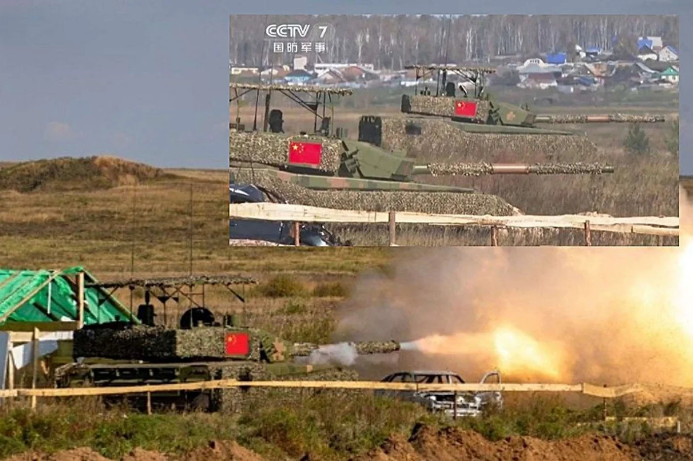

*图 11：中国 99A 主战坦克的伪装覆盖与顶部防护笼，展示了覆盖材料与支撑框架的结合。图片：Chinese State Media，转载自 [Army Recognition](https://www.armyrecognition.com/news/army-news/2026/chinas-type-99a-deployment-in-russia-shows-how-pla-heavy-armor-is-adapting-to-modern-warfare)。[28](#ref-28)*

框架与覆盖材料结合后，可以同时承担不同任务：**框架或网面产生物理阻隔，伪装层改变颜色、纹理和轮廓，外部结构则改变来袭物与车辆本体接触的条件。** 图 11 中的 99A 坦克展示了这种组合：车体及炮塔覆有伪装材料，顶部另设防护笼。物理防护与视觉隐蔽由不同部分承担，并在同一平台上结合。[28](#ref-28)

### 防护效果取决于威胁类型与平台条件

投下来的弹药、携带爆炸物的 FPV 无人机、巡飞弹和攻顶反坦克导弹，在飞行方式、接触条件与毁伤机理上各有差异。网具和防护笼的作用也随之变化：阻碍小型旋翼无人机的结构，对其他弹药可能只有有限的防护作用。[25](#ref-25)[26](#ref-26)

外部结构可能改变弹药的触发与起爆位置，但毁伤变化取决于战斗部和接触条件。对于聚能战斗部，起爆距离与穿透能力之间有特定关系；增加间隔并不总能降低穿透。因此，防护设计需要针对具体威胁进行接触与毁伤试验。

防护与隐蔽有时还会发生冲突：外部框架增加体积和轮廓，覆盖层可能影响视野、设备使用、维修或人员进出。实际使用既要考虑阻隔能力，也要考虑损坏维护和平台功能。网具与防护笼通常作为分层反无人机体系中的被动防护，与探测、电子对抗及拦截能力共同发挥作用。[27](#ref-27)

| 类型 | 主要作用环节 | 设计重点 |
| --- | --- | --- |
| 传统视觉伪装网 | 发现与识别 | 背景融合、轮廓与纹理控制 |
| 多光谱伪装遮障 | 多种传感器的探测与识别 | 不同波段特征、热平衡、平台适配 |
| 防无人机网 | 飞行器接近与直接接触 | 物理阻隔、持续完整性、通行与维护 |
| 车顶防护笼 | 外部接触及攻击过程 | 对特定威胁的防护、车辆功能与结构代价 |
| 框架与伪装层结合的覆盖 | 探测与攻击 | 协调光谱特征、物理防护与平台功能 |

防无人机网与车顶防护笼拓展了人工遮障的物理防护功能。遮障发展由此呈现出两条并行路径：一条通过功能材料精细管理多光谱特征，另一条通过低成本材料和就便结构干扰来袭物。两者都在适应不断变化的侦察与攻击手段。

## 八、前沿研究：让材料在不同波段做不同的事

### 1. 选择性热辐射：既降低探测波段信号，也要有散热通道

如果只把整个红外范围的发射率压低，物体通过热辐射散热的能力也可能降低。对持续产热的目标而言，最初看起来较弱的红外信号，可能伴随真实温度上升。前沿研究因此尝试**在不同波段分别设计辐射响应**。

Qin 等人在 2023 年《Light: Science & Applications》发表的研究，用多层结构控制可见光和红外响应，并在 2.5—3 μm、5—8 μm 波段提供辐射散热通道，使降低探测波段信号与释放热量能够在同一表面上结合。[9](#ref-9)

这些散热波段的大气透过率相对较低，远距离观测信号更容易被大气衰减。实际散热能力则由表面温度、环境辐射以及传导、对流等传热途径共同决定。

2026 年，Jiang 等人在《Nature Communications》报道铝—聚酰胺 66 双层薄膜，通过层级设计兼顾中、长波红外及激光波段响应与辐射散热，并研究可扩展生产。这类薄膜研究将光谱设计与材料加工联系起来，为大面积覆盖层提供了新的候选材料。[17](#ref-17)

这一方向的价值，是尝试解决“减少某些可观测信号”与“维持合理热平衡”的冲突。其成果有可能用于覆盖层或其他表面系统，距离柔性网具应用还需要机械、环境与整系统验证。

### 2. 可变发射率：不只改变温度，也改变表面如何辐射

Salihoglu 等人在 2018 年《Nano Letters》报道石墨烯自适应热伪装器件，通过电控制调节表面发射率。它展示了除加热、冷却之外的另一种思路：改变材料与热辐射的相互作用。[18](#ref-18)

从器件走向大面积自适应覆盖层，还需要改善响应速度、可调范围、封装、循环寿命和供能。可见光颜色与红外发射率属于不同的调节对象，兼顾两者需要多种材料或结构协同工作。

BAE Systems 的 ADAPTIV 则采用电驱动热像素路线，通过对单元分别加热和冷却，改变车辆的红外外观。与调节发射率相比，这条路线直接控制单元温度，热响应速度与供能需求是重要的工程约束。[19](#ref-19)

### 3. 双波段解耦：一幅“热图案”未必能应对两种热像仪

2026 年 7 月，Maman 等人在《Light: Science & Applications》发表超表面研究，在同一平台上实现中波、长波红外的像素级发射响应设计，并展示两个波段可以呈现不同图案。[20](#ref-20)

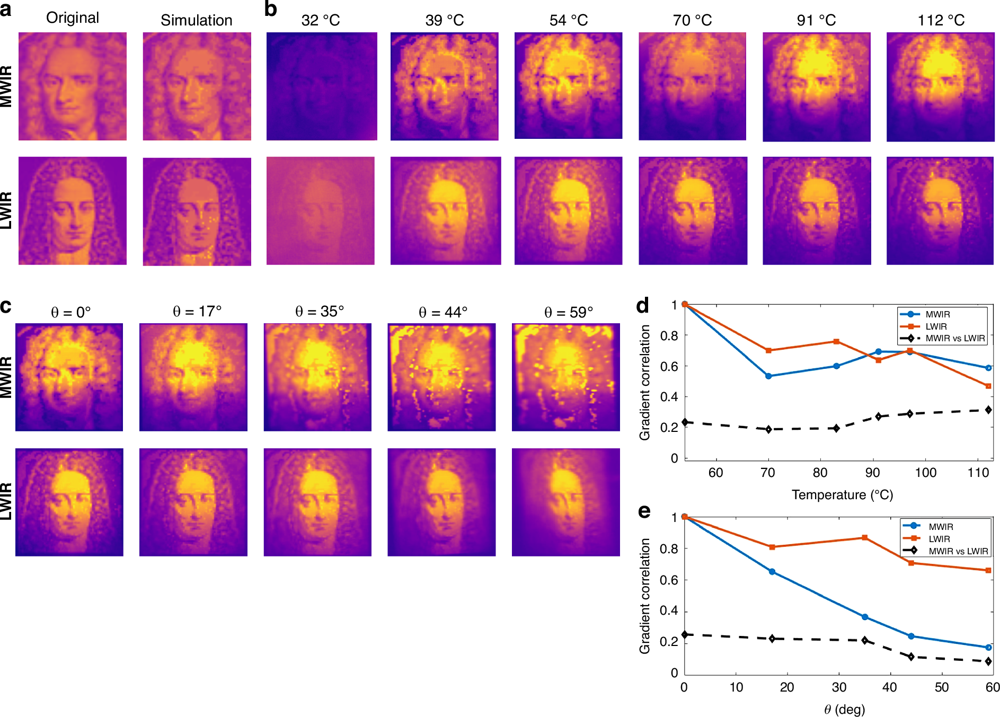

*图 12：同一芯片在中波、长波红外中呈现不同的热图像。Maman 等，2026，原论文图 5，完整转载，许可：[CC BY 4.0](https://creativecommons.org/licenses/by/4.0/)。[原论文](https://doi.org/10.1038/s41377-026-02426-y)。[20](#ref-20)*

图中中波红外通道呈现牛顿肖像，长波红外通道呈现莱布尼茨肖像；温度和观察角度改变时，图案保真度也发生变化。通过像素级光谱设计，同一表面可以在不同波段呈现不同的空间图案。[20](#ref-20)

红外伪装因此可以从单一的“热外观”，发展为针对不同波段分别设计的辐射图案。这项实验通过结构几何控制响应，图案在制造时确定；要进一步实现柔性、大面积和动态调节，还需要解决结构加工与驱动方式等问题。[20](#ref-20)

### 4. 从地面覆盖层到空间目标的热管理

2025 年《Space-to-ground infrared camouflage with radiative heat dissipation》将选择性光谱设计用于空间目标，结合地面红外观测波段控制与空间环境下的散热。空间缺少与周围空气的对流换热，向外部环境辐射热量尤其重要，因而对散热波段的选择提出了不同要求。[21](#ref-21)

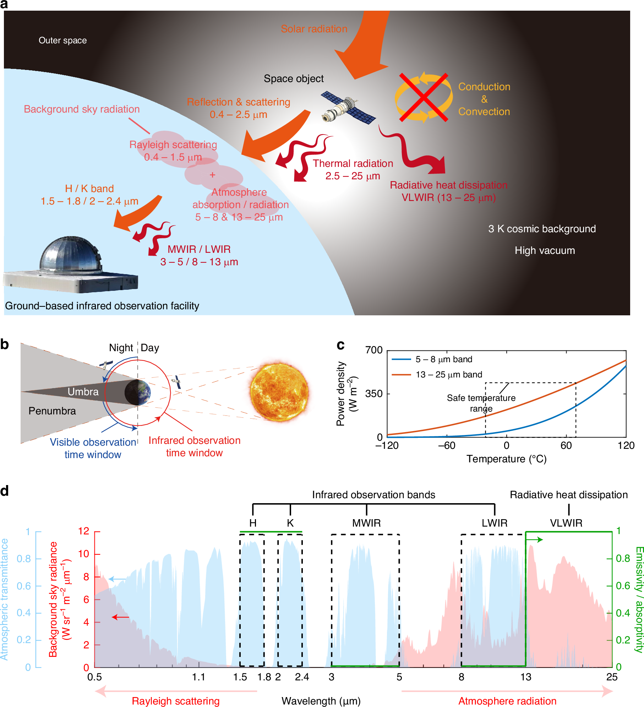

*图 13：空间目标对地红外伪装与辐射散热原理。a：信号来源与传输路径；b：可见光与红外观测时间窗口；c：两个候选波段的辐射功率密度；d：大气透过率、天空背景辐射与理想光谱响应。Qin 等，2025，原论文图 1，完整转载，未作修改，许可：[CC BY 4.0](https://creativecommons.org/licenses/by/4.0/)。[原论文与高清图](https://www.nature.com/articles/s41377-025-01824-y/figures/1)。[21](#ref-21)*

图 13a 中，地面观测者接收到的信号有两种来源：目标反射的太阳光，以及目标自身发出的热辐射。图 13d 的绿色曲线将两者分开处理：在 H、K 波段提高吸收率，减少太阳光反射；在中波、长波红外观测窗口降低发射率，减弱自身热辐射；在 13—25 μm 波段提高发射率，为热量保留出口。蓝色与红色背景分别表示大气透过率和天空背景辐射，说明材料设计还要考虑信号传播到地面时会发生什么。[21](#ref-21)

为什么选择 13—25 μm 散热？图 13c 表明，在论文关注的温度范围内，这一波段比 5—8 μm 能提供更大的辐射功率密度；同时，它向地面传播时受到较强的大气吸收。由此，空间表面可以在降低地面可接收信号的同时，通过另一个波段向外辐射热量。[21](#ref-21)

从地面网具到空间表面，光谱设计都需要同时考虑热源、散热环境与观测路径。**材料怎样辐射，既决定自身的热平衡，也决定传感器能够接收到什么信号。**

## 九、未来：最难的不是“变色”，而是保持整系统一致

材料功能不断增加，也使遮障设计面临更多相互牵制的要求。未来的发展将集中在以下几个方面。

**第一，功能兼容会比单项极值更重要。** 一个表面可能在热像中减少辐射，却增加环境反射；改变导电结构可能影响雷达响应，也可能影响通信。未来的评价需要把多波段、热平衡和本方设备使用放在同一组约束里。[9](#ref-9)[15](#ref-15)[17](#ref-17)

**第二，柔性与耐久会决定材料能否走出实验室。** 在小样片上获得所需光谱，只完成了问题的一部分。卷折、污染、雨水、磨损、维修和大面积制造，都会考验覆盖系统。2026 年薄膜研究强调生产可扩展性，正说明这一环节值得单独研究。[17](#ref-17)

**第三，自适应需要形成感知—调节—反馈的闭环。** 系统需要识别背景，确定颜色、温度或发射率的调节目标，再根据观测结果持续修正。背景随光照、天气和观察方向变化，多波段协调与低功耗控制将是大面积智能覆盖系统的重要研究课题。[18](#ref-18)[19](#ref-19)[20](#ref-20)

**第四，整系统测试将更加重视环境适应性。** 在材料光谱和电磁测试之外，还需要考察遮障覆盖完整目标后的表现，包括不同背景、光照、温度和观察方向下的隐蔽效果，以及操作人员能否方便地架设、撤收和维护。[12](#ref-12)

**第五，隐蔽与物理防护将更多地结合。** 多光谱覆盖层、承力结构和防无人机阻隔可以组成复合遮障。设计时需要控制附加结构产生的轮廓与电磁特征，保持平台正常使用，并兼顾损坏后的维修和功能恢复。[25](#ref-25)[27](#ref-27)

回看这一百多年，伪装网的一条主线是减少人工目标与背景之间可被利用的差异：从轮廓与阴影，到光谱、热辐射和电磁散射。广义遮障的另一条主线，则是利用外部遮蔽物干扰攻击，使目标即使被发现，也不一定能被来袭武器直接接触和有效毁伤。两条路径正在更多的覆盖系统中相遇。

早期网具没有因为新材料出现就失去意义，被动遮障也不会简单地被主动表皮替代。它们承担的任务、成本和维护条件不同。真正值得关注的，是每一项新技术究竟改变了哪一种可观测特征，又为此付出了怎样的工程代价。

## 参考文献与资料来源

网页访问日期：2026-10-13。

1.  Musée de l’Armée. *Animals and war, episode 17: The Cow and The Bull*. 2017. [法国陆军博物馆原文](https://actualites.musee-armee.fr/expositions-en/animals-and-war-episode-17-the-cow-and-the-bull/?lang=en)。
2.  Australian War Memorial. *This captured 6 inch German gun has been effectively hidden by draping camouflage netting…*. 馆藏 EZ0176，约 1916—1917 年。[馆藏记录](https://www.awm.gov.au/collection/C358197)。
3.  U.S. War Department. *FM 5-20A: Camouflage of Individuals and Infantry Weapons*. 9 February 1944. 参见开头检查清单、地空观察说明及机枪遮障章节。[公开扫描本](https://www.ibiblio.org/hyperwar/USA/ref/FM/PDFs/FM5-20A.PDF)。
4.  Fowlkes, J. F. *All work was done under close supervision of U.S. Army inspectors…*. 1942. Library of Congress，LC-USZ62-134614。[照片与权利记录](https://www.loc.gov/pictures/item/2005684116/)。
5.  Saab. *From fishing nets to camouflage*. 4 July 2018. [企业史原文](https://www.saab.com/markets/brasil/historias/2018/from-fishing-nets-to-camouflage)。
6.  *The Engineer*. *New Desert Camouflage Screen Receives Classification*. Fall 1975, p. 3. [美国陆军存档 PDF](https://home.army.mil/wood/7217/8429/9084/Fall_1975.pdf)。
7.  National Reconnaissance Office. *CORONA*. [官方历史资料](https://www.nro.gov/About-NRO/history/history-corona/)。
8.  U.S. Geological Survey. *Landsat 1*. [官方任务与传感器资料](https://www.usgs.gov/landsat-missions/landsat-1)。
9.  Qin, B., Zhu, Y., Zhou, Y., Qiu, M. & Li, Q. *Whole-infrared-band camouflage with dual-band radiative heat dissipation*. **Light: Science & Applications 12**, 246 (2023). [DOI: 10.1038/s41377-023-01287-z](https://doi.org/10.1038/s41377-023-01287-z)。
10.  Saab. *Barracuda MCS*. [车辆覆盖系统产品资料](https://www.saab.com/products/mcs-mobile-camouflage-system)。
11.  U.S. Army, PEO CS&CSS. *Army netting modernized camo*. 4 June 2018. [陆军报道](https://www.army.mil/article/206368/army_netting_modernized_camo)。
12.  Rogers, G. A. *Modernizing Army Camouflaging Technology*. **The Point Position**, 3(1), March 2018, pp. 4–5. [Aberdeen Test Center 期刊](https://www.atec.army.mil/atc/ATC_PointPosition/ThePoint_V3_N1.pdf)。
13.  U.S. Army. *FY2027 RDT&E Budget Justification, Volume 3, Budget Activity 5B*. April 2026. 参见项目 FG4 / Ultra-Lightweight Camouflage Net System。[预算说明 PDF](https://www.asafm.army.mil/Portals/72/Documents/BudgetMaterial/2027/Discretionary%20Budget/rdte/RDTE%20-%20Vol%203%20-%20Budget%20Activity%205B.pdf)。
14.  Saab. *Saab’s New Adjustable Camouflage Announced*. 12 June 2018. [面板可调系统公告](https://www.saab.com/newsroom/press-releases/2018/saabs-new-adjustable-camouflage-announced)。
15.  Saab. *Fully camouflaged with full communication*. 5 September 2023. [ULCAS-FSS 技术说明](https://www.saab.com/newsroom/stories/2023/september/fully-camouflaged-with-full-communication)。
16.  Clay, B. *A Soldier-Led Solution*. **Army AL&T**, Winter 2025；陆军网页发布于 20 March 2025。[公开报道](https://www.army.mil/article-amp/283908)。
17.  Jiang, Y. et al. *Hierarchical design and scalable production of radiative cooling film featuring multispectral camouflage*. **Nature Communications 17**, 2253 (2026). [DOI: 10.1038/s41467-026-69045-4](https://doi.org/10.1038/s41467-026-69045-4)。
18.  Salihoglu, O. et al. *Graphene-Based Adaptive Thermal Camouflage*. **Nano Letters 18**(7), 4541–4548 (2018). [DOI: 10.1021/acs.nanolett.8b01746](https://doi.org/10.1021/acs.nanolett.8b01746)。
19.  BAE Systems. *ADAPTIV*. [电驱动热像素产品说明](https://www.baesystems.com/en-uk/product/adaptiv)。
20.  Maman, R., Mazurski, N., Goykhman, I. & Levy, U. *Metasurface platform for simultaneous and uncorrelated emissivity control over MWIR and LWIR spectral bands*. **Light: Science & Applications 15**, 329 (2026). [DOI: 10.1038/s41377-026-02426-y](https://doi.org/10.1038/s41377-026-02426-y)。
21.  Qin, B. et al. *Space-to-ground infrared camouflage with radiative heat dissipation*. **Light: Science & Applications 14**, 137 (2025). [DOI: 10.1038/s41377-025-01824-y](https://doi.org/10.1038/s41377-025-01824-y)。
22.  福建省国防动员办公室网站（原人防资料）.《人民防空常用术语》. 5 November 2014. 参见“遮障”条目。[政府公开术语资料](https://gdb.fujian.gov.cn/ztzl/rfts/rfzs/rfzs/201411/t20141105_482246.htm)。
23.  Scottish Government. *Supporting Ukraine’s defence against Russia*. 22 February 2026. [废旧养殖网转作防无人机网的政府公告](https://www.gov.scot/news/supporting-ukraines-defence-against-russia/)。
24.  Ministry of Defence of Ukraine. *The State Special Transport Service set up more than 534 km of anti-drone protection in 2025*. 12 January 2026. [道路防护网建设记录](https://mod.gov.ua/en/news/the-state-special-transport-service-set-up-more-than-534-km-of-anti-drone-protection-in-2025)。
25.  Taylor, J. *Rethinking Survivability*. **Engineer Professional Bulletin**, 21 April 2026. [陆军工兵刊物原文](https://home.army.mil/wood/contact/publications/engr_mag/Rethinking-Survivability)。
26.  Kostiuk, B., Patiuk, D.-M., Shapochkina, A. & Tenenbaum, É. *Mapping the MilTech War: Eight Lessons from Ukraine’s Battlefield*. **Focus stratégique**, No. 132, Ifri, February 2026. 参见第 50—51 页笼状防护与战场适应讨论。[研究报告 PDF](https://www.ifri.org/sites/default/files/2026-02/ifri_tenenbaum_et_al_miltech_war_ukraine_2026_0.pdf)。
27.  Watling, J. & Bronk, J. *Protecting the Force from Uncrewed Aerial Systems*. RUSI Occasional Paper, 15 October 2024. [分层反无人机防护研究](https://www.rusi.org/explore-our-research/publications/occasional-papers/protecting-force-uncrewed-aerial-systems)。
28.  Nicanci, T. S. *China’s Type 99A Deployment in Russia Shows How PLA Heavy Armor Is Adapting to Modern Warfare*. Army Recognition, 6 October 2026. [报道原文](https://www.armyrecognition.com/news/army-news/2026/chinas-type-99a-deployment-in-russia-shows-how-pla-heavy-armor-is-adapting-to-modern-warfare)。
29.  The Royal Parks. *The Camouflage School at Kensington Gardens*. 7 October 2023. [学校历史与制作人员](https://www.royalparks.org.uk/read-watch-listen/camouflage-school-kensington-gardens)。
30.  Solomon, S. J. *Strategic Camouflage*. London: John Murray, 1920. [美国国会图书馆藏本](https://www.loc.gov/item/20009204/)。
31.  U.S. War Department. *FM 5-20B: Camouflage of Vehicles*. April 1944. 参见第 30—31 页阴影、第 42—45 页车辆覆盖网、第 53 页制式网具。[公开扫描本](https://ciehub.info/ref/FM/5-20B_1944.pdf)。
32.  Imperial War Museums. *Spies, Lies and Deception: Exhibition Guide*. 2023. 参见 Operation Bertram 与 Sunshield 覆盖结构。[展览大字版说明](https://www.iwm.org.uk/sites/default/files/files/2023-10/spies_large_print_guide.pdf)。
33.  Pattison, P. *D-Day Deception: Operation Fortitude South*. English Heritage. [假目标与无线电欺骗](https://www.english-heritage.org.uk/visit/places/dover-castle/history-and-stories/d-day-deception)。
34.  Sullivan, A. *Fort Leonard Wood examines WWII ‘Ghost Army’ deception tactics*. U.S. Army, 9 June 2021. [幽灵军团历史](https://www.army.mil/article/247350/fort_leonard_wood_examines_wwii_ghost_army_deception_tactics)。
35.  Министерство обороны СССР. *Инструкция по применению табельного маскировочного комплекта «МКТ»*（MKT 制式伪装套件使用说明）. Москва: Военное издательство, 1963. 参见第 3—7 页套件结构及构件连接。[历史手册数字化本](https://djvu.online/file/PhvxU1q0rySrG)。
36.  郑万里，杨萍，闫少强，吴丰轩，燕松. 军事伪装技术研究现状及发展趋势分析. **现代防御技术**，2022，50(1)：81—86. [DOI: 10.3969/j.issn.1009-086x.2022.01.012](https://www.xdfyjs.cn/CN/10.3969/j.issn.1009-086x.2022.01.012)。
37.  *Encyclopædia Britannica*, 12th edition, Vol. 30. “Camouflage,” 1922. 参见军事伪装部分的材料演变与炮位覆盖结构。[历史条目全文](https://en.wikisource.org/wiki/1922_Encyclop%C3%A6dia_Britannica/Camouflage)。
38.  Lockheed Martin. *Lockheed During World War II: Operation Camouflage*. 1 October 2020. [伯班克工厂伪装史](https://www.lockheedmartin.org/en-us/news/features/history/camouflage.html)。

39.  Brooke, J. W. *Camouflage Techniques on the Western Front, 1914–1918: Making camouflage netting at Basseux*. 16 June 1918. Imperial War Museums，Q 6752。[馆藏与图片许可](https://www.iwm.org.uk/collections/item/object/205091950)。
40.  Myre, G. *Drones buzz overhead, troops hunker underground in Ukraine’s hellish kill zone*. NPR, 5 October 2026，WHCP 转载。道路防护网照片：Iryna Rybakova／乌克兰第 93 机械化旅，经 AP 分发。[报道与图片署名](https://www.whcp.org/2026-10-05/drones-buzz-overhead-troops-hunker-underground-in-ukraines-hellish-kill-zone)。
