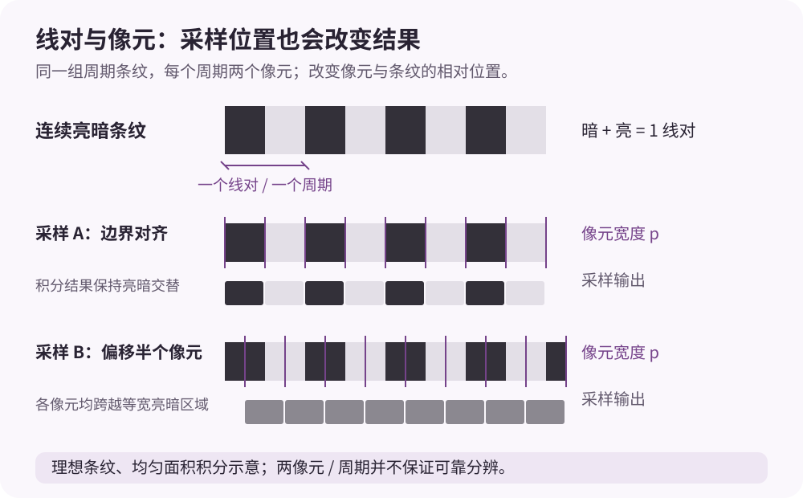
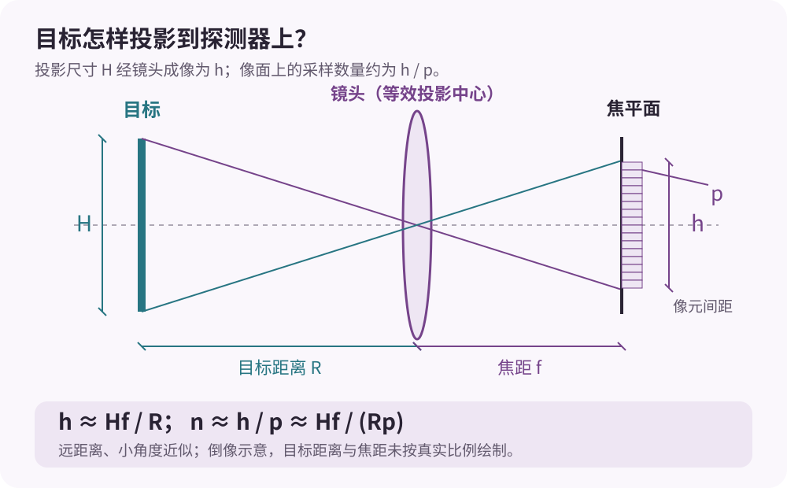
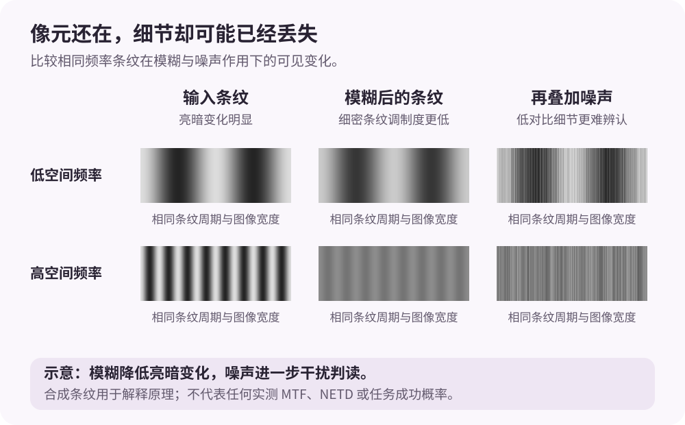

评价一台相机时，我们很容易先看分辨率。但在远距离成像中，整幅图像有多少像元，并不能直接告诉我们目标是否可辨。更值得关注的是：**目标在图像里占多大，以及这些像元保留了多少有效细节。**

同一辆车，近处可能占据几百个像元，远处只剩一个模糊亮斑。我们对它的判断也随之变化：先是发现“那里有东西”，然后看出“那是一辆车”，最后才有机会分辨它属于哪一种具体车辆。

Johnson 准则试图为这些观察任务提供一个可计算的尺度。不过，要正确使用它，首先需要弄清楚：它描述的究竟是像元数量，还是可分辨的信息量？

这个问题也会出现在伪装效果评估中。我们常听到“目标与背景的亮度对比应足够小”“红外温差应低于某个数值”，却未必清楚：这些参数是在近处测，还是在某个观察距离上测？测得差异很小，是否就意味着远处无法发现目标？要回答这些问题，需要把目标特征、成像条件和观察任务连接起来。

## 从观察任务说起

Johnson 准则通常用来讨论三个层次的目标判读任务，也就是常见的 DRI：

| 任务 | 要回答的问题 | 示例 |
| --- | --- | --- |
| Detection，探测 | 有没有目标？ | 发现背景中存在一个目标 |
| Recognition，识别 | 属于哪一类目标？ | 判断是车辆还是人员 |
| Identification，确认 | 是类别中的哪一种？ | 区分已知候选中的具体车辆类型 |

这里的“确认”需要放在指定任务中理解。区分两种外形差别很大的车辆，与区分两种轮廓接近的型号，所需的信息并不相同。

经典 Johnson 数据通常以目标关键尺寸上的**可分辨线对数**表示。常见的名义值是：探测约 1 个线对，识别约 4 个线对，确认约 6.4 个线对；这些数值对应约 **50% 的任务成功概率**，而不是达到后就必然成功。[FFI 技术报告：Thermal sensor acquisition range estimation，§2.3](https://www.ffi.no/en/publications-archive/thermal-sensor-acquisition-range-estimation)

历史数据还包含判断目标朝向的 Orientation 任务；本文围绕常见的 DRI 三类任务展开。这里的 50% 是规定判读条件下的经验成功率，不能直接解释为观察者在任意复杂背景中、规定时间内搜索到目标的概率。

因此，Johnson 准则更适合作为经验性的性能尺度。它把空间分辨能力与观察任务联系起来，但没有给出一个对所有目标、背景和观察条件都成立的硬门槛。

## 为什么常听到“2、8、13 个像元”？

一个线对由一条亮线和一条暗线组成，也可以理解为一个亮暗变化周期。如果按每个周期约两个采样点做简化换算，就得到：

| 任务 | 名义线对数 | 简化换算的采样像元数 |
| --- | ---: | ---: |
| 探测 | 1 | 约 2 |
| 识别 | 4 | 约 8 |
| 确认 | 6.4 | 约 13 |

这张表容易记，也适合初步估算，但“两个采样点”并不意味着一定能够可靠分辨一个周期。

设想黑白条纹恰好以每个周期两个像元的间隔被采样：像元与条纹之间的相对位置不同，采样结果就可能明显不同。再加上光学模糊、像元面积积分和噪声，原本存在的亮暗变化可能变得很弱。

所以，约 13 个像元只能说明目标具有一定的**几何采样规模**，不能直接证明图像中保留了 6.4 个可分辨线对。

*图 1：线对与像元并非同一个概念。图中采用理想周期条纹和均匀面积积分模型：在每周期两个像元的特殊采样条件下，仅改变相对位置，就可能使亮暗交替的输出变成均匀灰色。该图说明采样相位的影响，不表示真实目标的判读概率。*

这里还要区分另一种情况：一个很小但很亮的目标，即使不足一个像元，也可能产生可检测信号。发现这样的未分辨目标，与依靠空间结构识别目标，是不同的问题。不能把“探测约需两个像元”理解为任何目标都必须覆盖两个像元才能被发现。

## 目标尺寸应该取哪一个？

计算目标覆盖像元数时，常见表达式是：

$$
n_{\mathrm{pix}}=\frac{H}{s}
$$

其中，$H$ 是目标在所分析方向上的投影尺寸，$s$ 是该方向上每个像元对应的目标面采样间距。这里最容易被忽略的变量，其实是 $H$。

一辆车的长度可能很大，但用于区分车型的结构可能集中在车宽、车高或局部部件上。直接把最大的外形尺寸代入，会把几何估算距离推得更远。经典 Johnson 方法使用规定的目标关键尺寸；后续模型也可能采用其他等效尺寸定义，因此尺寸口径需要与所用模型保持一致。[FFI 技术报告：Thermal sensor acquisition range estimation，§2.3](https://www.ffi.no/en/publications-archive/thermal-sensor-acquisition-range-estimation)

写计算结果时，最好明确交代：

- 使用的是哪个方向的投影尺寸；
- 目标呈现什么观察姿态；
- 希望完成什么判读任务。

“目标长 7 米”是一条几何信息；“这 7 米就是确认任务应采用的关键尺寸”则需要另外论证。

## 从焦距和像元尺寸推算距离

在远距离、小角度近似下，像元的角采样间隔可以写为：

$$
\alpha_{\mathrm{pix}}\approx\frac{p}{f}
$$

其中，$p$ 是像元间距，$f$ 是焦距，二者应使用相同的长度单位。目标距离为 $R$ 时，一个像元在目标面上对应的采样间距约为：

$$
s\approx R\frac{p}{f}
$$

这里的目标面按近似垂直于视线处理；倾斜平面上的实际地面采样距离还需要考虑投影几何。

于是：

$$
n_{\mathrm{pix}}\approx\frac{Hf}{Rp}
$$

如果暂时采用一个指定的像元数要求 $n_{\mathrm{req}}$，便可以反推距离：

$$
\boxed{R_{\mathrm{geom}}\approx\frac{Hf}{n_{\mathrm{req}}p}}
$$

这里特意写成 $R_{\mathrm{geom}}$，因为它表示**几何采样估算距离**。计算中还没有纳入对比度、噪声、光学传递和大气传播等条件。

*图 2：远距离成像的几何关系。利用相似三角形可得像高 $h\approx Hf/R$，再除以像元间距 $p$ 得到采样数量。镜头以等效投影中心表示；目标距离和焦距未按真实比例绘制。*

举一个算例，暂时把 7 米作为所分析方向的投影尺寸：

$$
H=7\ \mathrm{m},\qquad f=0.2\ \mathrm{m},\qquad p=15\times10^{-6}\ \mathrm{m}
$$

取简化的确认任务要求 $n_{\mathrm{req}}=13$，则：

$$
R_{\mathrm{geom}}=\frac{7\times0.2}{13\times15\times10^{-6}}
\approx7179\ \mathrm{m}\approx7.18\ \mathrm{km}
$$

这个结果的含义是：在上述几何条件下，7 米的投影尺寸大约覆盖 13 个像元。它尚不能支持“系统可以在 7.18 千米处确认某种车辆”的结论。除了系统性能尚未计入，还需要判断所选尺寸是否适合该确认任务。

尺寸选择对结果的影响很直接。同样的镜头、像元间距和像元数要求，如果采用的投影尺寸是 2.3 米，几何估算距离就变成：

$$
R_{\mathrm{geom}}=\frac{2.3\times0.2}{13\times15\times10^{-6}}
\approx2.36\ \mathrm{km}
$$

这是一个假设尺寸的对照计算，却足以说明：写清楚“按什么尺寸计算”，与写清楚焦距和像元间距同样重要。

## 像元数量够了，为什么仍然看不清？

像元数量描述采样规模，而图像细节还需要经过成像系统传递。

MTF，即调制传递函数，用来描述系统对不同空间频率的调制度传递能力。对适用的线性成像系统，以正弦亮暗图样为输入，并将直流响应归一化后，可以把某一空间频率上的 MTF 理解为输出调制度与输入调制度之比：

$$
\mathrm{MTF}(\nu)=\frac{m_{\mathrm{out}}(\nu)}{m_{\mathrm{in}}(\nu)}
$$

其中 $\nu$ 表示空间频率，$m$ 表示相对于平均信号的调制度，可写为 $m=(I_{\max}-I_{\min})/(I_{\max}+I_{\min})$；通常约定 $\mathrm{MTF}(0)=1$。正弦图样的 MTF 与方波条纹的对比度传递不能未经转换就视为完全相同。[Edmund Optics：Introduction to Modulation Transfer Function](https://www.edmundoptics.com/knowledge-center/application-notes/optics/introduction-to-modulation-transfer-function/)

较低的空间频率对应缓慢变化的亮暗分布，较高的空间频率对应更细密的结构。真实目标的轮廓和边缘都包含多个频率成分，不能严格分成“轮廓只有低频、细节只有高频”。不过，同一个目标的大致形状仍然可见时，用于区分类别或型号的细节确实可能已经难以辨认。

对于可以按线性、空间不变环节近似的成像链，并统一空间频率与方向，系统 MTF 可以近似表示为各环节 MTF 的乘积：

$$
\mathrm{MTF}_{\mathrm{sys}}(\nu)\approx
\mathrm{MTF}_{\mathrm{opt}}(\nu)
\mathrm{MTF}_{\mathrm{det}}(\nu)
\mathrm{MTF}_{\mathrm{motion}}(\nu)\cdots
$$

这也解释了为什么“镜头很好”仍不等于“整机一定看得清”：像元积分、运动模糊和其他环节都会影响最后的细节表现。

不过，这种乘积写法有适用条件。采样混叠，以及非线性的降噪、锐化或图像重建，不能都简单归结为一个固定的 MTF 因子。

从工程角度看，我们需要知道的不是目标理论上能容纳多少周期，而是：在当前对比度和噪声条件下，还有多少周期能够被分辨。热像仪性能评估中，MRTD 正是连接可分辨空间细节与温差条件的一种方法。[研究论文：Thermal Imager Range: Predictions, Expectations, and Reality](https://pmc.ncbi.nlm.nih.gov/articles/PMC6696215/)

## 红外成像还要考虑温差和噪声

在热成像系统中，空间采样只是其中一个条件。本文的温差讨论针对中波、长波等热红外成像；近红外反射成像还需要考虑照明与反射特征，不能统一套用温差判据。

目标与背景的温度、发射率和环境辐射会影响到达传感器的信号差异。传播路径上的吸收和路径辐射又会改变这种差异。即使目标占据足够多的像元，它也可能因为与背景过于接近而难以判读。

NETD，即噪声等效温差，是评价热像仪噪声与温度灵敏度的常用指标。在规定测试条件下，较低的 NETD 通常意味着系统能够响应更小的温差信号。它描述的是噪声相关的灵敏度，不能直接等同于绝对测温准确度。

但把它概括成“NETD 决定能不能看到，MTF 决定能不能看清”，仍然过于简单。细节要被辨认，既需要保留足够的空间调制度，也需要高于噪声和背景干扰。两者共同影响任务表现。

*图 3：用合成条纹说明调制度与噪声的共同影响。各列的条纹周期和图像宽度相同，示意模糊使高频调制度下降、噪声使弱细节更难辨认。图中灰度与噪声均为解释原理而设置，不代表实测 MTF、NETD 或系统性能。*

MRTD，即最小可分辨温差，则把“空间频率”和“需要多大温差才能分辨”联系起来。传统的 Johnson–MRTD 距离模型，会根据传播后的目标背景温差确定可分辨空间频率，再将其换算为目标上的可分辨周期数，评估任务表现。[研究论文：Measurement and Analysis of the Parameters of Modern Long-Range Thermal Imaging Cameras](https://pmc.ncbi.nlm.nih.gov/articles/PMC8434484/)

## 伪装效果评估，到底应该在多远测？

理解了空间采样和信号传递，再回到伪装评估中的距离问题。首先需要分清楚：是在测材料和目标的物理特征，还是在测观察者完成任务的能力？

| 评估层次 | 要回答的问题 | 距离的作用 |
| --- | --- | --- |
| 材料或表面特征 | 反射率、发射率、表面温度等是什么？ | 根据测量方法、样品和仪器要求确定 |
| 目标与背景差异 | 指定条件下，目标与背景的亮度或辐射差多少？ | 需要记录距离、观察角度、波段和空间分辨能力 |
| 观察任务表现 | 目标在某个距离上能否被发现、识别或确认？ | 距离是评估变量，需要与成功概率或搜索时间一起报告 |

TNO 的伪装评估综述区分了物理测量、图像计算和观察者试验，并指出：物理特征测量与伪装表现有关，但不能单独直接预测完整的伪装效果。[TNO：Review of Camouflage Assessment Techniques，§1.3](https://publications.tno.nl/publication/34634869/4Wzsm9/toet-2019-review.pdf)

所以，“应该抵近测，还是远距离测”需要根据所回答的问题确定。如果想了解伪装表面与背景的特征差异，可以选择足以分别测量指定区域的工作距离。如果想判断某种观察系统在特定距离上的发现能力，就需要在对应成像条件下评估任务表现。Johnson 准则不能直接规定一个适用于所有伪装材料的测量距离。

*图 4：伪装评估的三个层次。特征测量为模型提供输入，成像条件决定可利用的信息，观察试验检验任务表现。Johnson–MRTD 或 TTP 参与成像质量与任务表现之间的联系，不能把材料指标直接变成通用的发现概率。*

### 近处测得准，与远处看不见，是两件事

在可见光评估中，“亮度对比度”首先需要明确计算口径。例如，以背景亮度为基准，可以采用 Weber 对比度：

$$
C_{\mathrm{W}}=\frac{L_{\mathrm{t}}-L_{\mathrm{b}}}{L_{\mathrm{b}}}
$$

其中 $L_{\mathrm{t}}$ 和 $L_{\mathrm{b}}$ 分别表示选定目标区域与背景区域的亮度，且 $L_{\mathrm{b}}>0$。评价差异大小时也可能使用其绝对值，但应在报告中明确。这只是一个定义示例，不能把使用其他定义得到的阈值直接套过来。相机图像中经过曝光、伽马或色调处理的灰度值，也不能未经校准就当作物理亮度。

红外评估中的“温差”同样需要说明口径：是真实表面温差，还是由所测辐射换算的表观温差？热像测量会受到发射率、反射表观温度和距离等参数的影响，因此表面温度接近不一定意味着红外辐射表现相同。[FLIR：Measuring temperatures](https://docs.flir.com/T810664/en-US/latest/s08.html)

还有一个很容易误判的现象：距离变远后，测得的温差变小。原因可能包括传播衰减，也可能是目标或局部热点不再被充分分辨，像元内混入了背景信号。这两种情况都需要与目标表面本身的特征变化区分开来。

但不能因此认为“只要距离变远，温差必然变小”。在忽略传播损失、观察方向和目标状态不变、目标仍充分填充测量区域的理想条件下，已分辨表面的辐射亮度不会仅因距离增加而按平方反比下降。总接收通量与单位立体角的辐射亮度需要区分；真实表面温度也不会因为观察者后退而改变。[FLIR：Infrared Imaging Radiometry Handbook](https://support.flir.com/Answers/A4456/IR_Imaging_Radiometry_Handbook.pdf)

**能看到目标，不等于能准确测出它的温度。** FLIR 的距离与测量区域说明以覆盖至少约 $3\times3$ 像元作为相关测温建议；具体要求仍需按所用仪器确认。这个测温条件与 Johnson 的任务判读条件用途不同，不能互相替代。[FLIR：Understanding Distance:Size Ratio](https://www.flir.com/en-ca/discover/professional-tools/understanding-distancesize-ratio/)

近距离特征测量时，距离选择应保证被测区域得到充分分辨，并满足对焦、校准和测量不确定度要求。远距离图像中的表观差异，则包含了传播、空间混合和成像系统的共同影响。两种结果都有意义，但需要标明各自的测量口径。

### Johnson 准则怎样连接特征差异与观察距离？

可以把这个连接过程理解为：目标与背景的特征差异，经传播和成像后成为图像信号；观察者再利用图像中可分辨的信息完成任务。Johnson 准则参与的是从可分辨空间信息到任务表现的经验联系。

以传统 Johnson–MRTD 方法为例，假设某项任务所需的可分辨周期数为 $J$，目标的角尺寸约为 $H/R$，那么相关角空间频率可以写为：

$$
\nu_{\mathrm{req}}(R)\approx\frac{J}{H/R}=\frac{JR}{H}
$$

这里 $H$ 与 $R$ 使用相同长度单位，$\nu_{\mathrm{req}}$ 按周期每弧度表示。距离越远，同样数量的周期被压缩进更小的角尺寸，对系统分辨能力的要求随之提高。在该简化方法中，还需要满足相应的温差信号条件：

$$
\Delta T_{\mathrm{app}}(R)\gtrsim\mathrm{MRTD}\!\left(\nu_{\mathrm{req}}(R)\right)
$$

其中 $\Delta T_{\mathrm{app}}(R)$ 表示传播后、作为成像模型输入的目标背景等效表观温差幅度，并非直接取经过增强处理的显示灰度差。MRTD 曲线必须采用一致的空间频率单位、测量条件和温差口径；若曲线以周期每毫弧度给出，需先换算。该关系说明温差信号与空间分辨要求需要一起考虑；它不是适用于所有目标和背景的发现概率公式，也不能把 NETD 直接当成右侧阈值。[Thermal Imager Range: Predictions, Expectations, and Reality，§2](https://www.mdpi.com/1424-8220/19/15/3313)

因此，“温差低于某个固定值”不能自动证明目标无法被发现；“目标占够 13 个像元”也不能自动证明目标能够被确认。即使几何尺寸不变，降低可利用的目标背景差异，也可能减少可分辨细节，使任务表现发生变化。反过来，平均差异很小的目标仍可能存在明显的局部热点、边缘或轮廓。只测一个平均值，可能遗漏实际用于发现目标的线索。

### 怎样报告一个更完整的伪装评估结果？

物理特征报告可以说明目标在什么条件下更接近背景。观察任务报告则应交代：使用什么波段与设备、在什么距离和背景中、允许多长观察时间，以及发现或识别表现如何变化。

观察者是否预先知道目标位置也需要说明。盯着指定位置判断目标是否可辨，与在整幅场景中搜索目标，是不同任务。若采用自动算法，还应报告相应判定阈值与虚警条件。对于同类方案比较，同条件下设置对照比孤立地报告一个数值更便于解释。[TNO：Review of Camouflage Assessment Techniques，§1.1、§2.1–2.2](https://publications.tno.nl/publication/34634869/4Wzsm9/toet-2019-review.pdf)

一份容易解释的评估结果，至少应能回答以下问题：

- 测的是反射率、物理亮度、表面温度，还是图像中的表观差异？
- 目标区域和背景区域如何选择，除了平均值是否考虑了局部差异？
- 使用什么波段、设备和镜头，测量距离与角度是多少，相关区域占多少像元？
- 环境和目标状态是什么，做了哪些校准或补偿，测量不确定度如何？
- 如果声称改善了发现或识别表现，对应的任务、观察时间、对照和概率依据是什么？

这样，近距离测量帮助解释特征差异的来源，距离相关的观察试验帮助验证任务效果，而成像模型负责在明确条件下连接两者。

## 怎样把 Johnson 准则用得更有价值？

对于初步方案比较，Johnson 准则提供了一个很直观的入口：目标越大、焦距越长、像元间距越小，通常越容易获得更多目标采样点；任务要求越高，需要保留的信息也越多。

但要把估算推进到可信的作用距离，需要逐步补齐条件：

1. 定义探测、识别或确认任务，并给出期望成功概率。
2. 确定目标姿态、投影尺寸与尺寸口径。
3. 用焦距和像元间距计算几何采样规模。
4. 纳入光学传递、噪声、目标背景差异和大气传播。
5. 用适合该系统与任务的性能模型及试验结果验证。

## TTP 方法是什么，与 Johnson 准则有什么区别？

TTP 的全称是 **Targeting Task Performance**，这里可译为“目标判读任务性能”。它是一种用于预测观察者探测、识别和确认表现的成像质量度量，需要结合目标尺寸与任务标定来估计成功概率。[Hixson 等：Target detection cycle criteria when using the Targeting Task Performance Metric](https://digitalcommons.memphis.edu/facpubs/14310/)

经典 Johnson 方法用最高可分辨空间频率乘以目标角尺寸，得到目标上的可分辨周期数。TTP 则在可见频率范围内，对目标表观对比度与系统对比度阈值的比值进行非线性加权积分，再结合目标角尺寸形成任务性能指标。它会对频率范围内的阈值变化作出响应，而不是只保留最高可分辨频率这一个数。[Vollmerhausen 与 Jacobs：The Targeting Task Performance (TTP) Metric，§6，NTIS 报告记录](https://ntrl.ntis.gov/NTRL/dashboard/searchResults/titleDetail/ADA422493.xhtml)

可以用一个概念例子理解：两幅图像的最细条纹都刚好可辨，但其中一幅的大轮廓和中等尺度结构更清楚。只比较最高可分辨频率，可能难以区分两者；TTP 的评价会对这些尺度上的可见性差异作出响应。相关模型也为采样成像、随频率变化的噪声以及高频增强等现代成像条件提供了处理方法。[Vollmerhausen 等：New metric for predicting target acquisition performance](https://experts.arizona.edu/en/publications/new-metric-for-predicting-target-acquisition-performance-2/)

对伪装评估而言，这提示我们需要关注不同尺度上的可利用差异，而不能只盯着一个平均温差或像元数量。但常用 TTP 模型本身仍可能用一个标量表观对比度概括目标，不能把它理解为自动分析所有局部热点、纹理和背景杂波的图像算法。目标位置是否已知、观察时间和观察者经验等，也仍需通过适合任务的模型或试验处理。它的任务标定值不能直接沿用 Johnson 的“1、4、6.4 线对”；经典数值适合建立直觉，具体系统评估则需要与所采用的模型保持一致。

## 从像元数量回到任务表现

回到最初的问题：目标占了 13 个像元，就能看清吗？

仅凭这个数字，还无法回答。我们还需要知道这些像元对应哪个目标尺寸，保留了多少可分辨细节，以及在怎样的背景和噪声条件下完成什么任务。

对伪装评估而言，还要再问一步：测得的低对比度或小温差，是目标与背景的物理特征更接近，还是传播与成像使差异变得难以分辨？这种差异又是否带来了发现或识别表现的改善？

Johnson 准则的价值，在于让“看清”成为一个可以讨论、计算和验证的问题。把像元数量、有效分辨能力、特征差异和任务成功概率分别说清楚，才能进一步讨论伪装在什么距离、什么条件下有效。
