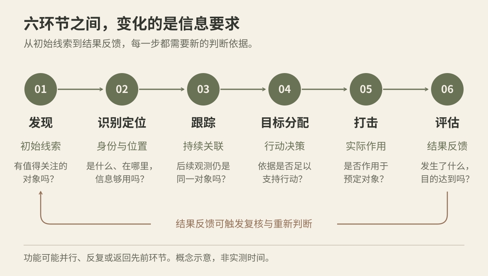
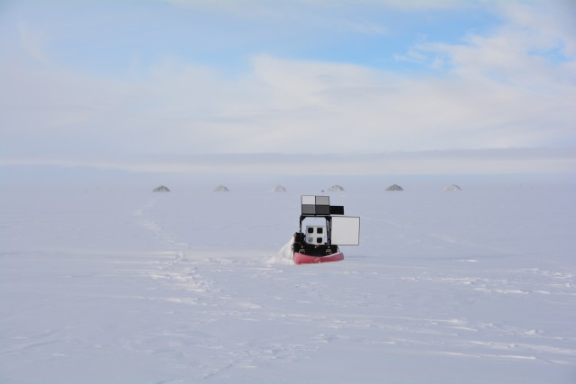
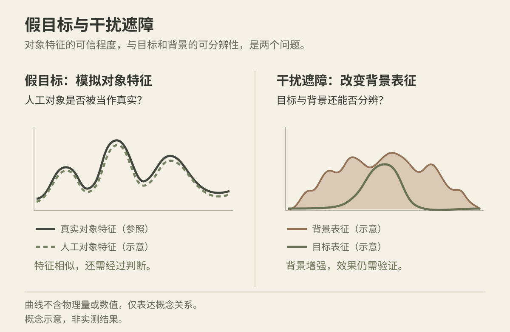
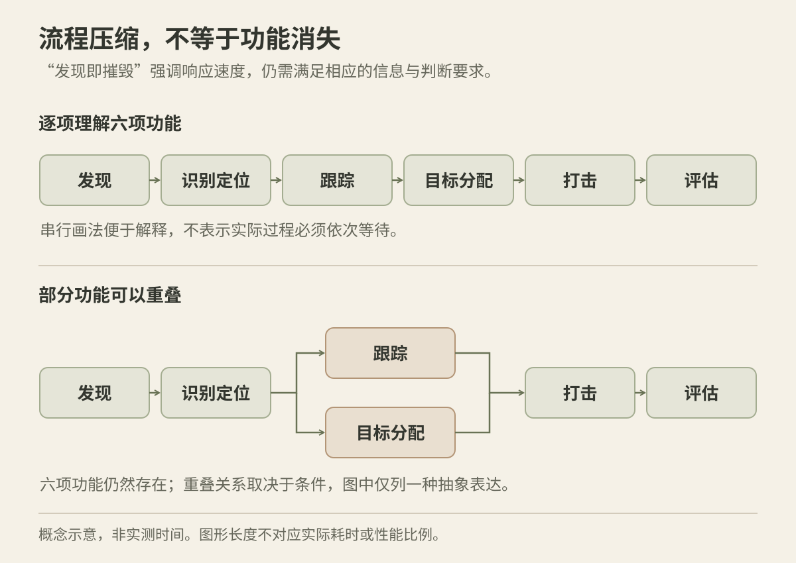

在树皮上找一只停着的蛾，往往要经历几次判断。起初只看到斑驳的纹理，接着觉得某一小块不太协调，再仔细看，才辨出翅膀和身体。

“那里好像有东西”和“我认出它是什么”，是两回事。换成连续画面，还要确认后面出现的是否仍是刚才那一只。目标从背景中显露出来，只是观察过程的开始。

这也是我想从杀伤链角度整理伪装的原因。发现阶段，伪装主要减少真实目标的可疑征候；进入后续环节，它还可能影响身份确认、位置更新、连续跟踪，以及对价值和状态的判断。**前一道防护失效，不等于后面的防护都失去了意义。**

烟幕和角反射器尤其能说明这种目的变化。它们既可参与示假，也可用于遮蔽或干扰；真实目标的细节可能因此更难分辨，措施自身却又成为新的异常。先沿六个环节梳理伪装，再回头讨论这笔取舍，比较容易看清它们各自在做什么。

## 六环节及中文术语

F2T2EA 是 Find、Fix、Track、Target、Engage、Assess 的缩写。美国空军《目标工作》条令用它描述动态目标处理过程。[AFDP 3-60](https://www.doctrine.af.mil/Portals/61/documents/AFDP_3-60/3-60-AFDP-TARGETING.pdf)

| 环节 | 这一环节要完成什么 | 伪装针对的问题 |
| --- | --- | --- |
| Find：发现 | 从背景中发现值得进一步调查的线索 | 减少真实目标引起注意的征候 |
| Fix：识别定位 | 确认身份，取得足够准确的位置等信息 | 隐藏类别与状态细节，影响可靠位置的形成 |
| Track：跟踪 | 持续更新位置，维持同一对象的身份关联 | 影响连续观察与身份对应 |
| Target：目标分配 | 判断优先级，匹配能力、预期效果与授权 | 通过隐真、示假影响真实性与价值判断 |
| Engage：打击 | 执行已经确定的行动 | 影响行动中仍然依赖的对象与位置确认 |
| Assess：评估 | 判断实际效果，反馈后续决策 | 隐藏真实状态，或造成评估对象混淆 |

中文表述采用王泽隆、徐向辉、张雷在《中国科学院大学学报》论文中的译法：“发现、识别定位、跟踪、目标分配、打击、评估”。[王泽隆等，2020](https://html.rhhz.net/ZGKXYDXXB/20200411.htm)

其中两处值得单独记下。Fix 同时涉及身份确认与位置确定；Target 包含目标决策、资源匹配和授权，含义比日常说的“瞄准”更宽。MITRE 2004 年报告第 1-2 页解释了两者的功能，第 5-4 页将 Fix 标为“Identify and Locate Targets”。[MITRE 技术报告](https://www.mitre.org/sites/default/files/pdf/04_0962.pdf)

六环节是功能划分，实际过程可以并行、反复，也会返回先前环节。它属于目标工作的一部分；较大的联合目标工作循环还涉及目标与指导、目标开发、能力分析等内容。2013 年版 JP 3-60 保留了这一层次关系，可作历史资料参照。[JP 3-60，2013 年版](https://www.justsecurity.org/wp-content/uploads/2015/06/Joint_Chiefs-Joint_Targeting_20130131.pdf)

## 隐真、示假与欺骗

隐真和示假，面对的是两个不同的对象。隐真希望真的东西少显露特征，迷彩涂装、伪装网和覆盖材料是常见例子；示假则制造人工线索，让观察者面对一个看起来可信的假对象。假目标有时恰恰需要被看见。

欺骗还要再往后看一步：人工线索是否改变了认识，进而改变行为。做出一件外观逼真的假目标，与形成完整的欺骗效果，处在不同的评价层次。美国陆军 ADP 3-13 将伪装、隐蔽等放在信息保护中讨论；Pikner 的文章则区分隐藏真实线索与制造虚假线索的作用。[ADP 3-13，2023](https://rdl.train.army.mil/catalog-ws/view/100.ATSC/B704630A-BF73-4EA5-8994-9EE4E300269B-1701200317950/adp3_13.pdf)、[Pikner，2021](https://www.armyupress.army.mil/Journals/Military-Review/English-Edition-Archives/March-April-2021/Pikner-Military-Deception/)

遮蔽和干扰又有自己的作用方式：有的限制信号传播，有的改变目标与背景的可分辨关系。它们可能让某些细节难以辨认，却不一定让整个场景安静下来。后面讨论烟幕和雷达干扰遮障时，这一点很重要。

六环节也不是六种器材的分工表。同一种覆盖材料可能同时影响发现和识别，同一个假目标可能继续进入跟踪和价值判断。更有用的梳理方法，是看措施改变了哪些特征，以及这些变化影响了哪一步判断。

## 发现：减少真实目标的可疑征候

发现往往从一个很小的不协调开始。它可能是颜色或明暗的差别，也可能是一段规则边缘、一道阴影，或者运动带来的变化。观察者先注意到这处差异，然后才把它组织成“这里有一个对象”的判断。发现阶段的伪装，首先要研究这些线索从哪里来。

迷彩涂装主要改变表面的颜色和图案；伪装网与覆盖材料还会改变可见的纹理、轮廓和结构。它们可以帮助对象融入背景，也可能使原本完整、熟悉的外形不再容易被一眼认出。几种措施常被放在一起讨论，但各自改变的特征并不完全相同。

树皮上的蛾说明了这个差别。翅膀颜色接近树皮，减少了一类反差；翅膀边缘、阴影或局部运动，仍可能留下另一类线索。只说“颜色很像”，还不足以解释伪装为什么有效，或者为什么失效。

观察方式改变，暴露线索也会改变。普通照片记录相应光照下的可见光外观，热像和雷达记录的是另外的信号。多光谱伪装把这些表现放在一起考虑，还要处理不同波段与热管理之间的约束。[Zhu 等，2021](https://www.nature.com/articles/s41467-021-22051-0)、[Jiang 等，2026](https://www.nature.com/articles/s41467-026-69045-4)

多光谱伪装网就是一个具体的器材类别。美国陆军装备手册将 ULCANS 的设计用途描述为降低可见光、红外和雷达特征。这说明“藏起来”可以针对多种观测渠道，具体表现仍随材料和使用环境而变。[美国陆军《武器系统手册》，2020—2021](https://www.army.mil/e2/downloads/rv7/2020-2021_Weapon_Systems_Handbook.pdf)

图片来源：[U.S. Army，2018-06-04](https://www.army.mil/article/206368/army_netting_modernized_camo)。

## 识别定位：轮廓可见，身份与位置仍可能不清楚

发现回答“那里有没有东西”，识别定位要继续回答“它是什么、具体在哪里”。一个对象已经引起注意，类别、真伪、状态和准确位置却可能尚未确认。伪装在这里仍有作用空间。

覆盖材料与外形遮蔽可以减少辨认依据。对象也许还在画面中，但用于区分类别的局部结构看不清了，熟悉的轮廓也不完整。此时伪装改变的是“能认出多少细节”。外观模拟和假目标则走向另一面：人工对象显示出某些真实对象的特征，使观察者面对真实性判断。

位置还要分清层次。在照片里圈出一个对象，得到的是图像位置；要把它对应到现实空间，还需要相应的测量信息。知道某个区域有对象、获得一次位置记录、掌握当前足够准确的位置，是逐步增加的认识，不能合并成一个“定位成功”。

烟幕与雷达干扰遮障可以放在这一层理解：它们改变后续观察条件，目的可能落在细节辨认和位置更新上。尤其当对象的存在已被察觉时，讨论的重点就变成后面还能确认到什么程度。它们也会带来新的异常，这部分留在六环节之后集中讨论。

## 跟踪：看丢一段，与重新出现后认错对象

跟踪给身份和位置加上了时间。侦察方需要把不同时刻的信息接成同一个对象的连续记录；相应地，伪装研究也要从一张照片走向一段过程。

一只鸟飞入树冠，短暂看不到，不意味着先前的认识立即消失。等它重新出现，又要判断看到的是原来那只，还是另一只外观相近的鸟。“现在有没有观测”与“身份是否连续”，是两类问题。

遮蔽主要改变某些时刻能取得多少观测，假目标则可能增加需要区分的候选对象。前者对应观测缺口，后者对应关联混淆。迷彩和覆盖材料的作用也会随时间变化：静态画面里不明显的对象，可能因运动而显露；某次已经看清的对象，也可能在后续细节减少时变得难以持续辨认。

所以，跟踪中的伪装效果要看一整段记录：观测是否中断，持续多久，重新出现后是否仍被认作同一对象。已有坐标、历史轨迹和其他信息来源也在这段过程中发挥作用。一张遮蔽最明显的照片，能展示细节减少，却很难单独说明整段跟踪发生了什么。

## 目标分配：假目标怎样进入真实性与价值判断

到了目标分配，问题从“看到了什么”转向“这个对象值得投入什么资源”。身份、价值、优先级、可用能力和授权开始共同影响决定。前面留下的不确定性，有的会被复核消除，有的则会继续传到这里。

示假在这一环节的目的，是使人工线索进入对目标数量、真实性或价值的认识。形体假目标提供外观，其他特征模拟补充相应观测渠道中的线索。但“像”有两层：传感器看起来相似，是一层；结合已有信息后被认为可信，是另一层。

可以把假目标的作用拆成一条逐渐推进的关系：被发现，被认为真实，被赋予价值，最后改变资源安排。它在画面里很逼真，先说明某些特征具有说服力；一次误报，也可能在后续复核中被排除。真正触及目标分配的，是认识怎样传到了决策。

Acosta 与 Paul 将假目标作用与仿真程度、观察分析条件及资源负担联系起来；二战欺骗资料也显示，判断会受到物体之外的信息影响。[Acosta 与 Paul，2026](https://www.armyupress.army.mil/Journals/Military-Review/English-Edition-Archives/July-August-2026/Sensor-Symphony/)、[IWM 二战展览资料](https://www.iwm.org.uk/sites/default/files/files/2023-10/second_world_war_galleries_large_print.pdf)

这一环节让我更在意“做得像”之后的事：哪些特征使假目标被相信，哪些疑点引起复核，最后是否改变了对真实对象的判断。只展示假目标的照片，往往看不到这一段过程。

## 打击：对象确认仍可能延续到行动之中

打击把前面的判断转成实际行动。对某些系统而言，行动过程中仍需要继续感知、更新信息或确认作用对象。伪装的作用因此可能延续到这里，而不在“已经被跟踪”时一概结束。

在这一层，烟幕、多光谱遮蔽、雷达干扰遮障与假目标仍然通过感知过程起作用：有的减少可辨认细节，有的改变背景回波，有的增加对象混淆。它们改变的信号不同，对后续感知的影响也不同。ARL 关于遮蔽物的公开报道所研究的光谱透射特性，就是其中一种物理依据。[ARL，2014](https://www.army.mil/article/129701/researchers_improve_smokes_obscurants_technology)

这里需要把三层结果接起来看：观测发生变化，对象确认受到影响，实际作用结果改变。图像实验通常先回答前面的问题；涉及末端感知、制导与命中效果时，还要有对应系统的证据。保留这几个层次，才能说清某种伪装作用究竟延续到了哪里。

## 评估：看不清状态，与认错评估对象

行动完成以后，还要重新观察对象：状态是否改变，改变到什么程度，目的是否达到。评估会反馈到后续决策，因此也属于伪装需要考虑的信息过程。

这里有两种容易混在一起的情形。一种是**看不清**：覆盖或遮蔽使状态细节暂时不可见，观察者难以确认发生了什么。另一种是**看错了**：人工对象与真实对象被混淆，观察结果被归到了错误对象身上。前者留下未知，后者可能形成错误认识。

在评估环节，伪装的关注点从最初的发现，转到真实状态的确认。研究时要记录被观察的究竟是谁，以及观察结论与真实状态有什么差别。

评估中的伪装不会改变已经发生的毁伤，但会影响毁伤如何被认识、下一轮判断如何更新。杀伤链也由此形成回路：后来的观察，可能修正前面关于身份、位置和状态的认识。

## 烟幕与角反射器：示假、干扰与新增暴露

把六环节连起来以后，烟幕和角反射器的特殊之处就清楚了。它们可以减少真实对象的可辨认细节，却也可能让整个区域更醒目。这是讨论其用途时需要慎重的原因。

假设原先的雷达背景回波较弱、变化不大，后来突然出现一组亮点。真目标也许更难分辨了，场景却多了一处显眼的异常。烟幕同样如此：轮廓被遮住，烟云本身仍可能引起注意。**“遮蔽即暴露”说的就是这种并存的结果——对象细节可能更模糊，区域却未必更隐蔽。**

不过，异常出现在哪里、希望它被怎样理解，要按用途区分：

| 比较内容 | 示假 | 对真实对象的遮蔽或干扰 |
| --- | --- | --- |
| 希望改变什么 | 对人工线索真实性与价值的认识 | 对真实对象细节、位置或状态的认识 |
| 人工现象被注意到的意义 | 被看见可能正符合显示虚假线索的目的 | 可能在减少对象细节的同时，增加区域显著性 |
| 主要作用联系 | 识别、复核与目标分配 | 后续识别定位、持续观察与状态确认 |
| 需要分清的结果 | 假目标被发现、被相信、改变决策 | 细节减少、位置更新受影响、后续行动结果改变 |

假目标被看见，不等于真目标已经被发现；但两者是否会被关联，仍要结合其他线索判断。示假中的“有意显示”，与真实对象遮蔽带来的“新增异常”，不能当成同一笔暴露代价。

### 烟幕：显示人工线索，或改变观察通道

烟幕既有遮蔽用途，也有示假用途。术语资料分别列出遮蔽烟幕与诱惑烟幕，说明它既可以限制对真实对象的观察，也可以成为引导另一种认识的人工现象。[烟幕与示假相关术语](https://std.nscmi.com/pages/TerminologyDetail.aspx?typeid=3&urlid=0b13a1bdc7d9597f6298c416df718c10)

作为示假的一部分，烟云的可见性可能正是所要显示的线索。作为遮蔽，它改变的则是对象与观察者之间的信息通道：对象本身未必变了，但新的观测里，可用于辨认和更新位置的细节可能减少。

这种变化依赖相应波段的透射特性。ARL 的报道测量从可见光到远红外的透射表现，并介绍双波段遮蔽物研究。肉眼看到浓烟，不能据此替所有传感器下结论。[ARL，2014](https://www.army.mil/article/129701/researchers_improve_smokes_obscurants_technology)

烟幕遮住的也是新的观察，并不会抹掉此前已经取得的信息。把这一点与跟踪环节连起来，就能理解为什么“这一帧看不清”与“后续无法继续判断”之间，还隔着历史记录、预测和其他观测。

### 角反射器：示假看相似性，遮障看可分辨性

角反射器本身不主动发射雷达信号，却可以在外来照射下形成较强回波。雷达影像里的“亮”首先表示回波强，而不是普通照片里的发光。ESA 的 IceSAR 试验就利用这种特征形成参考亮点，帮助校准影像。[ESA，2012](https://blogs.esa.int/campaignearth/2012/04/25/icesar-and-a-corner-reflector/)

**示假关心“这个人工对象像不像某种真实对象”。** 雷达散射截面，即 RCS，是描述散射特征的一个量。它不是简单的几何面积；某一条件下数值接近，也不代表完整特征都相同。角反射器可以参与这类雷达特征模拟，公开的 ODIN 资料将其列入欺骗相关手段。[美国陆军 ODIN](https://odin.t2com.army.mil/TC/e869aa38856bcc92802455eebf42b2ef)

**干扰遮障关心“真目标还能否从整体回波中分出来”。** 这时考虑的是多个器件的整体散射，以及人工杂波对目标与背景关系的改变。军事百科条目将增强背景回波、影响识别列为相关用途。[“雷达角反射器”条目](https://js.bkzx.cn/items?catId=26182)

阵列遮障有线形、面形等空间形态。其作用意图，是通过大量强散射回波降低真实对象的可分辨性。不过，阵列也可以参与特征模拟，数量与形态并不能单独决定用途。[角反射器阵列识别研究，2024](https://www.mdpi.com/2072-4292/16/12/2114)

NASA 对 SAR 的介绍同样说明，角反射器等强响应可以在影像中表现为亮点。因此，无源描述的是能量来源，并不意味着没有可观察的征候。[NASA：Get to Know SAR](https://science.nasa.gov/mission/nisar/get-to-know-sar/)

### 从降低可发现性，到影响暴露后的精确确认

我想强调的目的变化，就在这里。真实对象尚未引起注意时，背景融合追求的是少留下初始线索；当讨论一个存在已被察觉的对象时，问题变成后续还能否认清、精确定位并持续更新。**降低被发现的机会，与影响发现后的精确确认，是两类不同的防护目标。**

“定位拒止”可以用来描述后一类目标：大致区域可能已经为人所知，但可靠位置仍难以形成或保持。烟幕和雷达干扰遮障之所以不能简单写成“又一种藏起来的办法”，就在于它们可能保留甚至增加区域异常，同时影响对象层面的观察。

慎重之处，是要把这两种变化放在一起：真实对象是否更难辨认，人工措施是否又吸引了新的注意。前者是期待的收益，后者是新增的暴露代价。具体效果要沿着识别定位、跟踪和后续环节继续看，单凭烟云或亮点本身还不能定论。

## 检测与算法研究，怎样回到伪装设计

沿着六环节整理以后，检测、分割与跟踪研究的位置也更明确了：它们帮助解释暴露机理，检验伪装改变了什么。

COD，即伪装目标检测，研究如何从相似背景中找出对象。从伪装一侧阅读这些工作，更值得追问的是模型利用了哪条线索：完整轮廓、局部纹理、明暗反差，还是数据中的背景关联？Fan 等提供了任务与数据集入口；Lv 等进一步研究定位、分割与伪装程度排序，并将相关认识联系到伪装设计。[Fan 等，2020](https://openaccess.thecvf.com/content_CVPR_2020/html/Fan_Camouflaged_Object_Detection_CVPR_2020_paper.html)、[Lv 等，2021](https://openaccess.thecvf.com/content/CVPR2021/html/Lv_Simultaneously_Localize_Segment_and_Rank_the_Camouflaged_Objects_CVPR_2021_paper.html)

对抗性伪装进一步把模型的判断特征纳入设计。Duan 等讨论将对抗样例融入自然风格，Huang 等研究面向检测器的物理伪装攻击。[Duan 等，2020](https://openaccess.thecvf.com/content_CVPR_2020/html/Duan_Adversarial_Camouflage_Hiding_Physical-World_Attacks_With_Natural_Styles_CVPR_2020_paper.html)、[Huang 等，2020](https://openaccess.thecvf.com/content_CVPR_2020/papers/Huang_Universal_Physical_Camouflage_Attacks_on_Object_Detectors_CVPR_2020_paper.pdf) 对人眼自然、融入背景、使某个模型判断出错，这几种表现可能同时出现，也可能彼此分离。COD 是感知任务，对抗性伪装是设计方向，两者可以形成研究上的对抗关系，但不是严格对应的两个分类。

假如一种表面处理后，模型更难找到对象，下一步还要弄清原因：表面特征变了，还是光照、背景或成像分辨率变了？注意力图和分割图可以帮助查找线索，对照观察则帮助检验解释。只留下一句“分数下降”，很难成为下一次设计的依据。

指标也要跟着问题走。检测、分割主要反映对象提取，跟踪还要看身份关联，模型置信度与实际正确率又是另一件事。[COCO 评价实现](https://raw.githubusercontent.com/cocodataset/cocoapi/master/PythonAPI/pycocotools/cocoeval.py)、[COD 评价示例](https://openaccess.thecvf.com/content/CVPR2023/supplemental/Huang_Feature_Shrinkage_Pyramid_CVPR_2023_supplemental.pdf)、[HOTA](https://link.springer.com/article/10.1007/s11263-020-01375-2)、[分类校准](https://proceedings.mlr.press/v70/guo17a.html)、[检测校准](https://openaccess.thecvf.com/content/CVPR2023/html/Pathiraja_Multiclass_Confidence_and_Localization_Calibration_for_Object_Detection_CVPR_2023_paper.html)

最后希望接起来的，是这样一条解释：**伪装改变了什么物理特征，成像中因此留下什么线索，最终影响了哪一环节的判断。** 换了地点、天气或设备后，这条关系是否仍然成立，同样值得记录；分布偏移研究提供了一类可参考的评价思路。[WILDS](https://proceedings.mlr.press/v139/koh21a.html)

## “发现即摧毁”与流程压缩

读到这里，再看“发现即摧毁”，就不必把它理解成一条省略全部中间判断的捷径。更接近实际含义的，是信息到行动的转化被高度压缩。

2020 年《解放军报》讨论联合战术体时，也将这种速度建立在信息、火力链路和“侦、控、打、评”流程上。流程本身仍在，变化的是相关功能完成得有多快、交接等待有多少。[《打造“联合战术体”》](https://www.81.cn/jfjbmap/content/2020-02/13/content_253956.htm)

### 并行与前置准备

外部看到的首次发现，未必是内部准备的起点。已有情报、规则与资源准备，可能早于这一时刻完成；后面看起来很快的反应，包含了先前积累的工作。

六环节也是功能划分，不要求六项工作逐项排队。AFDP 3-60 提到，发现与确认在一些情况下可接近同时完成，部分目标决策也可与其他步骤并行。[AFDP 3-60](https://www.doctrine.af.mil/Portals/61/documents/AFDP_3-60/3-60-AFDP-TARGETING.pdf)

信息共享与自动化减少了交接和等待，于是外观看来只剩一个短促的“发现—打击”。但这并不说明身份、位置、授权与执行条件从此无需判断。

### 信息的有效时间

信息能否来得及使用，还取决于它过多久会变旧。地图上的公交站点位置相对稳定，一辆正在行驶的公交车则不同：几分钟前的位置记录可能完全正确，却已经不能回答“它现在在哪里”。

目标信息也有类似的时效问题。从观测到行动产生效果所用的时间，需要与相关信息保持有效的时间相匹配。更新速度、对象状态和观察条件都会改变这段关系，没有适用于所有场景的固定窗口。

完整循环还包括结果评估与反馈。因此，从发现到作用发生的时间，与把结果重新送回判断过程的时间，也应分别记录。把二者混在一起，容易让不同资料中的“闭合时间”失去可比性。

行动被执行、产生预期毁伤、最终达到任务目的，则是另外几个层次。2025 年《解放军报》关于现代杀伤链的论述将发展方向联系到决策行动闭环、网络化与智能化，阅读其中的能力描述时，仍需保留这些层次。[《把握现代杀伤链的构建要求》](https://www.81.cn/ll_208543/16403946.html)

所以，多环节流程与“发现即摧毁”并无冲突。前者拆开了信息和行动所需的功能，后者概括某些条件下转化可以有多快。压缩时间，不等于发现之后的所有不确定性都同时消失。

## 杀伤网带来的补偿问题

把过程画成一条链，很容易产生“一处断开，全线停止”的印象。杀伤网改变了这幅图：同一类信息可能由不同来源提供，不同传感器、决策节点与执行平台也可以形成多种组合。DARPA 的马赛克战构想及 ACK 演示，分别说明了网络化效果与跨域能力动态组合的思路。[DARPA，2017](https://www.darpa.mil/news/2017/sto-mosaic-warfare)、[DARPA，2020](https://www.darpa.mil/news/2020/cross-domain-kill-webs)

仍以观察一只鸟为例。一台相机暂时看不到，不代表另一台也看不到；两台相机都看到类似外形，也不代表它们已经正确对应到同一只鸟。信息来源增加了，补偿的可能性增加，新的关联与解释问题也随之出现。

这对伪装评价很重要：局部观测受影响以后，其他来源是否真的补上了所需信息，应当单独考察。单个传感器上的结果，只说明网络中的一部分。

当然，构想、演示与实际部署还有距离。GAO 2025 年报告记录了联合全域指挥控制建设中的数据共享、互操作与总体框架问题。[GAO-25-106454](https://files.gao.gov/reports/GAO-25-106454/index.html) 网络提供补偿的可能，补偿是否发生、能否及时发生，仍是实际观察的问题。

## 留下的研究问题

沿着六环节看，伪装的作用逐步展开：减少发现线索，隐藏身份与位置细节，影响连续关联，让人工线索参与价值判断，再延续到行动中的对象确认和事后的状态认识。同一种措施，放在不同环节里，研究问题也会变化。

后面还想继续追三件事：同一类材料在静态与连续观察中，作用为什么会变化；示假中的特征相似，怎样进一步影响真实性认识；遮障减少对象细节的同时，又怎样改变整个区域的显著性。

这些问题最后都要回到伪装设计。检测与识别研究帮助找出暴露线索，连续观测帮助理解作用能维持多久，而用途与新增暴露的比较，则提醒我把真实对象和整个场景一起看。下一步想积累的，是这些联系背后的解释。

## 参考资料

资料整理日期：2026 年 10 月 15 日。条令、研发说明、署名评论与实验论文分别提供概念、构想、分析和试验证据，引用时保留其原有范围。

1. [美国空军：AFDP 3-60, Targeting](https://www.doctrine.af.mil/Portals/61/documents/AFDP_3-60/3-60-AFDP-TARGETING.pdf)。理解 F2T2EA。官方[版本页面](https://www.doctrine.af.mil/Doctrine-Publications/AFDP-3-60-Targeting/)列出 2026-05-01 更新；本次详细条文核对依赖该官方 PDF 的检索可见文本，缓存可能对应较早版本，本文不据此声称某条表述是 2026 年新增内容。
2. [美国参谋长联席会议：JP 3-60, Joint Targeting，2013-01-31](https://www.justsecurity.org/wp-content/uploads/2015/06/Joint_Chiefs-Joint_Targeting_20130131.pdf)。历史原始文件，由 Just Security 托管；帮助区分联合目标工作循环与动态处理步骤。
3. [美国陆军：ADP 3-13, Information，2023-11-27](https://rdl.train.army.mil/catalog-ws/view/100.ATSC/B704630A-BF73-4EA5-8994-9EE4E300269B-1701200317950/adp3_13.pdf)。伪装、隐蔽与信息保护的概念入口。
4. [张怀奇、杨军宁：《打造“联合战术体”》，2020-02-13](https://www.81.cn/jfjbmap/content/2020-02/13/content_253956.htm)。查看“发现即摧毁”与流程协同在中文军事论述中的关系。
5. [李成乔、马娅娅：《把握现代杀伤链的构建要求》，2025-08-22](https://www.81.cn/ll_208543/16403946.html)。关于网络化、智能化发展的署名军事论述。
6. [Stephan Pikner: Leveraging Multi-Domain Military Deception to Expose the Enemy in 2035，2021 年 3—4 月刊](https://www.armyupress.army.mil/Journals/Military-Review/English-Edition-Archives/March-April-2021/Pikner-Military-Deception/)。区分降低真实线索与增加虚假线索的逻辑；属于前瞻分析。
7. [David Acosta、Christopher Paul: Beating the Sensor Symphony: Why Decoys Still Matter，2026 年 7—8 月刊](https://www.armyupress.army.mil/Journals/Military-Review/English-Edition-Archives/July-August-2026/Sensor-Symphony/)。讨论假目标仿真程度及观察分析条件；不宜当作统一效能试验。
8. [DARPA: Strategic Technology Office Outlines Vision for “Mosaic Warfare”，2017](https://www.darpa.mil/news/2017/sto-mosaic-warfare)。网络化效果与能力组合构想。
9. [DARPA: Creating Cross-Domain Kill Webs in Real Time，2020-09-18](https://www.darpa.mil/news/2020/cross-domain-kill-webs)。ACK 与 STITCHES 的演示说明；演示结果不等于全面部署效果。
10. [GAO: Defense Command and Control: Further Progress Hinges on Establishing a Comprehensive Framework，2025 年 4 月，GAO-25-106454](https://files.gao.gov/reports/GAO-25-106454/index.html)。从审计角度认识跨系统数据共享与建设难题。
11. [Huanzheng Zhu 等：Multispectral camouflage for infrared, visible, lasers and microwave with radiative cooling，Nature Communications 12, 1805 (2021)](https://www.nature.com/articles/s41467-021-22051-0)。DOI：10.1038/s41467-021-22051-0。
12. [Yi Jiang 等：Hierarchical design and scalable production of radiative cooling film featuring multispectral camouflage，Nature Communications 17, 2253 (2026)](https://www.nature.com/articles/s41467-026-69045-4)。2026-02-02 发表；DOI：10.1038/s41467-026-69045-4。
13. [Imperial War Museums: Second World War Galleries, Large Print Guide](https://www.iwm.org.uk/sites/default/files/files/2023-10/second_world_war_galleries_large_print.pdf)。二战欺骗的历史背景，不作为现代系统效能证据。
14. [Deng-Ping Fan 等：Camouflaged Object Detection，CVPR 2020，2777–2787](https://openaccess.thecvf.com/content_CVPR_2020/html/Fan_Camouflaged_Object_Detection_CVPR_2020_paper.html)。COD 问题与 COD10K 数据集的研究入口。
15. [COCO 官方评价实现：cocoeval.py](https://raw.githubusercontent.com/cocodataset/cocoapi/master/PythonAPI/pycocotools/cocoeval.py)。核对 AP、IoU 阈值、尺度及检测数量等评价设置；该链接指向可变化的主分支，正式实验应记录使用的具体版本。
16. [Chuan Guo 等：On Calibration of Modern Neural Networks，ICML 2017，PMLR 70:1321–1330](https://proceedings.mlr.press/v70/guo17a.html)。分类置信度校准的基础研究，不直接替代检测任务的校准定义。
17. [Bimsara Pathiraja 等：Multiclass Confidence and Localization Calibration for Object Detection，CVPR 2023，19734–19743](https://openaccess.thecvf.com/content/CVPR2023/html/Pathiraja_Multiclass_Confidence_and_Localization_Calibration_for_Object_Detection_CVPR_2023_paper.html)。检测中的类别置信度与定位校准。
18. [Jonathon Luiten 等：HOTA: A Higher Order Metric for Evaluating Multi-object Tracking，IJCV 129:548–578 (2021)](https://link.springer.com/article/10.1007/s11263-020-01375-2)。2020 年在线发表、2021 年卷期出版；DOI：10.1007/s11263-020-01375-2。
19. [Pang Wei Koh 等：WILDS: A Benchmark of in-the-Wild Distribution Shifts，ICML 2021，PMLR 139:5637–5664](https://proceedings.mlr.press/v139/koh21a.html)。真实场景分布偏移与评价划分的参考框架。
20. [Zhou Huang 等：Feature Shrinkage Pyramid for Camouflaged Object Detection with Transformers，CVPR 2023，补充材料](https://openaccess.thecvf.com/content/CVPR2023/supplemental/Huang_Feature_Shrinkage_Pyramid_CVPR_2023_supplemental.pdf)。评价小节列出了 COD 分割指标的实际用法。
21. [王泽隆、徐向辉、张雷：《基于仿真SAR图像深度迁移学习的自动目标识别》，中国科学院大学学报，2020，37(4):516–524](https://html.rhhz.net/ZGKXYDXXB/20200411.htm)。引言使用“发现、识别定位、跟踪、目标分配、打击、评估”，是六环节中文表述的依据。
22. [C. Don Means、Erika Darling、Janet Perron: Applying Cognitive Work Analysis to Time Critical Targeting Functionality，MITRE，2004 年 10 月](https://www.mitre.org/sites/default/files/pdf/04_0962.pdf)。报告编号 MTR 04B0000057；第 1-2、5-4 页用于核对 Fix 的识别与定位功能，以及 Target 的决策功能。
23. [美国陆军：Weapon Systems Handbook 2020–2021](https://www.army.mil/e2/downloads/rv7/2020-2021_Weapon_Systems_Handbook.pdf)。ULCANS 条目介绍多光谱伪装网的设计用途；不作为所有伪装网实际效果的保证。
24. [ARL Public Affairs: Researchers improve smokes, obscurants technology，2014-07-11](https://www.army.mil/article/129701/researchers_improve_smokes_obscurants_technology)。说明遮蔽物光谱透射率测量与双波段研究，用于区分不同波段的遮蔽效果。
25. [ESA: IceSAR and a corner reflector，2012-04-25](https://blogs.esa.int/campaignearth/2012/04/25/icesar-and-a-corner-reflector/)。以遥感校准说明角反射器的回波机制，不提供军事诱骗有效性证据。
26. [美国陆军 ODIN：对手信息战与欺骗手段资料](https://odin.t2com.army.mil/TC/e869aa38856bcc92802455eebf42b2ef)。将角反射器列入相关手段的公开概念资料，不作为具体部署或末端制导对抗效果的试验依据。

27. [Yunqiu Lv 等：Simultaneously Localize, Segment and Rank the Camouflaged Objects，CVPR 2021，11591–11601](https://openaccess.thecvf.com/content/CVPR2021/html/Lv_Simultaneously_Localize_Segment_and_Rank_the_Camouflaged_Objects_CVPR_2021_paper.html)。研究显著程度与伪装程度排序，任务说明将相关认识与伪装设计联系起来。
28. [Ranjie Duan 等：Adversarial Camouflage: Hiding Physical-World Attacks With Natural Styles，CVPR 2020](https://openaccess.thecvf.com/content_CVPR_2020/html/Duan_Adversarial_Camouflage_Hiding_Physical-World_Attacks_With_Natural_Styles_CVPR_2020_paper.html)。用于说明对抗性伪装中模型判断与自然外观的关系，不作为通用物理隐蔽效果证明。
29. [Universal Physical Camouflage Attacks on Object Detectors，CVPR 2020](https://openaccess.thecvf.com/content_CVPR_2020/papers/Huang_Universal_Physical_Camouflage_Attacks_on_Object_Detectors_CVPR_2020_paper.pdf)。面向目标检测器的物理伪装研究入口；不将论文中的受控实验外推为杀伤链对抗效果。
30. [《中国大百科全书》军事专业条目分类页：“雷达角反射器”](https://js.bkzx.cn/items?catId=26182)。检索可见条目说明其干扰遮障、靶标、信标与校准等用途；用于补充用途分类，不作为定位或制导对抗效果的试验依据。
31. [An Identification Method of Corner Reflector Array Based on Mismatched Filter through Changing the Frequency Modulation Slope，Remote Sensing，2024，16(12):2114](https://www.mdpi.com/2072-4292/16/12/2114)。用于说明阵列也可涉及特征模拟与识别问题，不将其中的阵列用途等同于所有干扰遮障。
32. [NASA：Get to Know SAR – Overview](https://science.nasa.gov/mission/nisar/get-to-know-sar/)。解释雷达照射、回波与影像明暗，可用于理解强散射体为何可能形成醒目的观察线索。
33. [标准资源共享平台：模拟伪装器材及烟幕相关术语](https://std.nscmi.com/pages/TerminologyDetail.aspx?typeid=3&urlid=0b13a1bdc7d9597f6298c416df718c10)。检索可见资料区分烟幕伪装、遮蔽烟幕与诱惑烟幕，用于辨别用途，不作为现行使用规定或具体效果依据。

### 延伸阅读

以下资料补充相关概念，不作为正文作用效果的证据：

- [DARPA: Guaranteeing AI Robustness Against Deception (GARD)](https://www.darpa.mil/research/programs/guaranteeing-ai-robustness-against-deception)。机器学习鲁棒性与场景化评价的研究入口。
- [Lockheed Martin: Cyber Kill Chain](https://www.lockheedmartin.com/en-us/capabilities/cyber/cyber-kill-chain.html)。用于区分网络安全中的同名概念。
- [NAVAIR：AMRAAM](https://www.navair.navy.mil/product/AMRAAM)。官方页面将 home-on-jam 列为应对电子干扰的一种导引模式，用于核对术语，不涉及实施或对抗方法。
